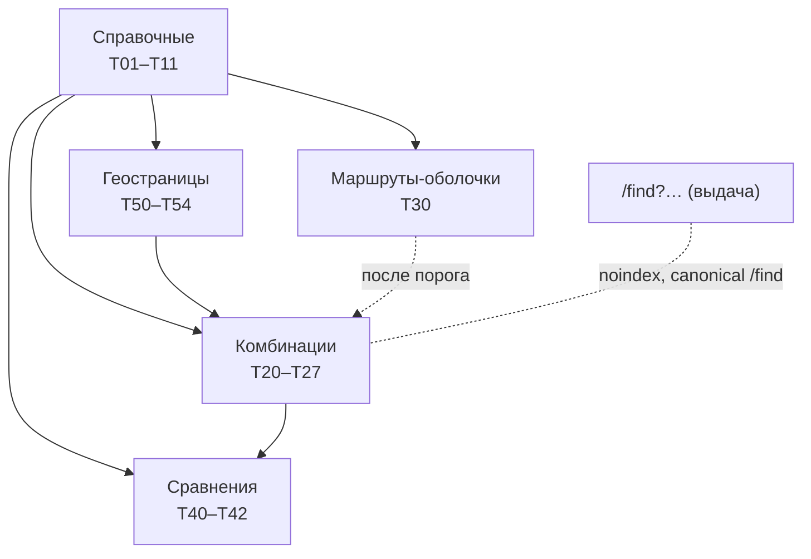

# 22. ТЗ: дерево SEO-страниц портала (генерация, сравнения, геопривязка)

Актуально на 12.11.2026. Версия 1. Поток 2 (воронка); к потоку 1 не относится. Собрано по промпту `docs/prompts/seo-page-tree-tz.md`.

**Источники.** `vault/portal-filters/dev-filters-schema.md` (код портала на 12.11.2026, обозначение ДС); `vault/portal-filters/filters-comparison.md`, `filters-vs-dev-tree.md`; `vault/seo-benchmark/page-structure.md`, `comparison-table.md` (бенчмарк, БМ); `seo-platform/01-model-ia.md`, `02-pseo.md`, `04-product.md`, `05-tech.md` (прежние решения, июль 2026, данные РФ, ПС); `docs/05`, `docs/10`, `docs/12`; указания владельца от 12.11.2026 (ВЛ); работа четырёх независимых проверяющих по ролям (АГ: поиск, данные, сравнения, разработка). Базы портала у автора нет: объёмы даны формулами и запросом (приложение Г).

**Разметка статусов.** Ф — факт из входа; О — оценка стороннего сервиса; В — вывод; П — предложение (значение по умолчанию, вносится в открытые решения); Г — гипотеза. Каждое требование имеет код `R-раздел.номер` и источник. «Ист.» — код источника из списка выше или П.

**Как читать.** Разработчик — разделы 2–12, 14, приложения. Владелец — разделы 1, 13, 15, 16.

---

## 1. Решения и сравнение источников

### 1.1 Решения владельца от 12.11.2026 (устные)

| № | Решение | Как учтено | Статус |
|---|---|---|---|
| ВЛ-1 | Место правды — портал Сергея; второй базы нет | Все страницы строятся из его данных (раздел 3); внешние данные хранятся отдельными слоями с источником | принято |
| ВЛ-2 | Добавить «Короткие программы» (в дереве Сергея нет, в концепте есть) | Новая сущность T11, раздел 3.2 | принято; сущность в базе отсутствует (Ф) |
| ВЛ-3 | Страницы сравнения «чисто под SEO»; потенциал «миллиард страниц» | Раздел 7. Миллиард не следует из входов (см. 5.4): это **Г**, решения на ней не строятся | принято частично |
| ВЛ-4 | Дерево возможных страниц, включая не существующие (образец — Авиасейлс) | Три состояния существования, раздел 2.3; оболочка, раздел 6.3 | принято |
| ВЛ-5 | Блоки — «из букинг-сервисов» | Берётся состав блоков и логика; данные и тексты не берутся (раздел 6, 10) | принято с ограничением по лицензии |
| ВЛ-6 | Геопривязка: достопримечательности, улицы, регионы; на вырост, модель сейчас | Раздел 8; генерация по этапам (раздел 13) | принято |
| ВЛ-11 (13.11.2026) | Режим контента распространяется на все типы страниц, включая вуз, колледж, школу, программу: в индексе они выглядят так, а подбор по своим параметрам пользователь делает поиском. Для уникализации владелец передаёт матрицу параметров с весами по типам страниц | R-4.4.9, R-4.4.10; матрица ещё не получена | принято; ждёт матрицу |
| ВЛ-10 (13.11.2026) | Страницы-маршруты как у Авиасейлс (`/routes/{из}/{в}`, `/routes/{из}`, `/countries/{страна}` с «в» и «из»): не выдают значений из базы по вузам и программам; уникальность — блоки текста; выдача строится после нажатия «Найти»; год набора отличается текстом | Раздел 4.4, режим контента | принято; риски раздела 4.4 |
| ВЛ-9 (13.11.2026) | Локализация: сначала английская версия, затем русская; страницы сразу на двух языках | `docs/24`; R-9.10 уточнён: основной язык — английский, `x-default` = en | принято |
| ВЛ-8 (13.11.2026) | Страницы из поиска не привязаны к пользователю: адрес формируется из выбранных параметров фильтра, открыт всем, включая роботов | Тип T43, раздел 4.3 | принято с условиями: пороги и канонизация обязательны |
| ВЛ-7 | Подборки сравнений из выбора пользователей (лайки, закладки), наборы 3–5, в том числе из разных городов и стран | Раздел 7.3. **Заблокировано до правового решения** по данным подростков (R-7.14) | принято, блокер |

### 1.2 Противоречия с прежними документами (прежние файлы не изменены)

| Тема | Прежнее решение (Ф) | Решение ВЛ / ограничение | Вердикт ТЗ |
|---|---|---|---|
| Индексация сравнений | `seo-platform/04-product.md`: страница сравнения `noindex`; `01-model-ia.md`: `/sravnenie/` не индексируется | ВЛ-3: сравнения для SEO | Индексируются **только** пары из белого списка (R-7.6). Остальное `noindex`. Прежнее правило отменяется для белого списка |
| Массовая генерация фасетов | `02-pseo.md` §2: «массовая генерация запрещена», кураторский слой ≈100–150 | ВЛ-3, ВЛ-4: широкое дерево | Генерация разрешена как **создание адресов**; в индекс попадают только страницы, прошедшие пороги (раздел 5). Кураторский слой остаётся для наборов по фильтрам |
| Порог «≥ 2 вузов» | `02-pseo.md`: посчитан по вузам РФ, 79 % комбинаций отсечено | Новые типы без порогов | Порог переносится как умолчание для комбинаций; для остальных типов задан заново (5.2), калибруется по показам |
| Размер сравнения | `04-product.md`: до 4 вузов | ВЛ-7: наборы 3–5 | 5 (R-7.1) |
| Хранение выбора | `04-product.md`, `01-model-ia.md`, `docs/05` п.1: избранное и сравнение только в браузере; ПДн не собираются; кабинета нет | ВЛ-7: агрегат выбора пользователей требует сервера | Прямое противоречие. Подборки (вид в) не включаются до решения юриста (R-7.14). Виды а и б не затрагивают ПДн |
| Закрытие параметров в robots.txt | `02-pseo.md` §3: параметры не закрывать, иначе не виден `noindex`; Skyscanner (Disallow) и Aviasales (Clean-param) закрывают (БМ §3); БМ §9 п.4 рекомендует их схему; у Booking параметры не проверялись (БМ §10) | — | Берём правило `02-pseo`: `noindex` + canonical; robots только для служебных путей и меток (R-9.8). Расхождение с рекомендацией БМ сознательное: закрытый в robots URL может остаться в индексе по внешним ссылкам (П; у Aviasales в Google в 6 раз больше страниц, чем в sitemap, причина не установлена, БМ §1) — основанием служит не это наблюдение, а логика `02-pseo` |
| Стек | `05-tech.md`: выбран Astro, Rust+HTMX — путь отхода | Код портала уже на Rust (`browse.rs`, HTMX-обработчики, ДС §2, §8) | Основание выбора устарело; ТЗ исходит из Rust (R-11.1) |
| `lastmod` | `02-pseo.md` §6: дата принятия снимка для всех | Единая дата на миллионах URL поисковик игнорирует (П) | `lastmod` — дата изменения хэша данных страницы (R-9.7) |
| Внутренняя неясность | `02-pseo.md` §6: «404 не отдаём … 302? Нет: 200 с noindex» | — | Итог 200 + `noindex`, принят |

### 1.3 Ограничения лицензий и поисковиков

- Booking, Skyscanner, Aviasales — образец состава блоков, не источник. Не копируются тексты, цены, отзывы, фото, списки объектов из их sitemap и страниц, структура их тематических подборок как набор данных. Партнёрские API — только на условиях договора, данные в портал не копируются (П: общее знание, сверить с условиями на дату запуска).
- Число URL в sitemap не равно числу страниц в индексе (Aviasales: 131 502 URL в sitemap, ≈ 796 тыс. в Google, О, БМ §1). Все оценки ниже — потолок или ставка.
- Массовый малоценный контент наказуем. Для каждого типа заданы порог индексации, правило тонкой страницы и порядок снятия (разделы 5, 9).
- Названия BFAS/Big Five и RIASEC в адресах и текстах не используются. Параметр `riasec` в ДС §5B (`/careers?riasec=S`) — публичный: его нужно переименовать (решение О-10), в подписях и текстах уже используются рабочие названия («с людьми», «с техникой» и т. д.).

---

## 2. Принципы

**R-2.1** Страница — это уникальный адрес, который отдаёт ответ 200 с собственным заголовком, текстом и набором данных. Состояние поисковой выдачи (`/find?...`) страницей для поиска не является (ДС §3.1: `noindex, follow`, canonical `/find`). Ист.: ДС.

**R-2.2** Ценность страницы = то, что посетитель не получит со страницы родителя и соседа: свой набор программ или вузов, свои агрегаты, своё сравнение, своя геопривязка. Нет такой разницы — страница не индексируется (R-2.5). Ист.: ПС §2 (довод о дубле и каннибализации), П.

### 2.3 Три состояния существования

| Состояние | Условие | Ответ | В sitemap | В перелинковке |
|---|---|---|---|---|
| **Материализована** | Данные есть и пороги раздела 5 выполнены | 200, `index` | да | да |
| **Оболочка** | Все сущности адреса существуют, пара допущена (`allowed_pair`), но данных меньше порога | 200, `noindex, follow`, canonical на себя | нет | только из форм и подборок «ближайшее» |
| **Не создаётся** | Любая сущность адреса не существует, адрес вне допущенного графа или не прошёл нормализацию | 404 (или 301 на канонический) | нет | нет |

**R-2.4** Каждая страница в каждый момент находится ровно в одном состоянии; решение принимает функция от данных, без ручных исключений (кроме белых списков, раздел 7). Критерий: тест «одни данные — одно состояние». Ист.: АГ-разработка, П.

**R-2.5 Правило тонкой страницы.** Если страница не проходит пороги индексации: (1) все сущности адреса существуют — страница остаётся живой как оболочка (`noindex`, canonical на себя); (2) страница, которая по составу данных совпадает с родителем (например, единственный вуз города), не создаётся как отдельная и получает canonical на родителя; (3) сущности нет — не создавать (404). Пороги относятся к **индексации**, а не к созданию адреса. Вход в индекс — после `H = 2` подряд пересборок с выполненными порогами; выход из индекса (понижающий гистерезис) — после двух подряд пересборок ниже порога (П).

**Соответствие слоёв.** «Существование» (раздел 2.3) и «индексация» независимы: материализованная страница может быть `noindex` (пары сравнения вне белого списка — материализованы, класс B, `noindex`); «оболочка» и «класс C» — одно и то же. Ист.: ПС §6, АГ-SEO.

**R-2.6** Оболочка отвечает 200, а не 404: она полезна посетителю (6.3). Риск soft 404 снимается тем, что она не в sitemap, имеет `noindex` и показывает реальные факты, а не заглушку. Ист.: ВЛ-4; риск — АГ.

---

## 3. Сущности и справочники

### 3.1 Из портала Сергея (Ф, по ДС)

| Код | Сущность | Адрес в портале сейчас | Ключевые поля из ДС |
|---|---|---|---|
| E01 | Страна | `/countries/{cc}`, `/universities/{cc}` | ISO-код, рынок, валюта, календарь сроков, фильтры страны |
| E02 | Город | `/universities/{cc}/{город}`, `to=cc/город` | страна, слаг |
| E03 | Вуз / E04 колледж | `/universities/…`, `/colleges/…` | финансирование, цена, страновые поля |
| E05 | Программа | страниц нет в разобранных файлах (пробел), карточки в `/find` | уровень, язык, форма, цена, срок, длительность, проходной балл, бюджетные места, места для иностранцев |
| E06 | Направление | `/fields/{slug}` | семейства CIP, сфера |
| E07 | Сфера | `/spheres/{slug}` | slug |
| E08 | Профессия | `/careers/{slug}` | тип работы, медиана зарплаты, риск ИИ, «хватит колледжа» |
| E09 | Олимпиада | `/olympiads` (только ru) | предмет, уровень, класс, вид льготы |
| E10 | Подборка редактора | `/collections/{slug}` | — |

Адреса слагов: транслитерация + идентификатор (`seo-platform/01-model-ia.md` В3). Языки интерфейса: ru, en в первом выпуске; kk, uz, ar — по готовности перевода (R-9.10). Ист.: ПС.

### 3.2 Новые сущности (отсутствуют в базе, Ф)

Общие поля новых сущностей: `id`, `slug`, `country_iso2`, `names{ru,en,ar,kk,uz}` с признаком «ручной / машинный», `lat`, `lon`, `status`, и для каждой записи `source`, `source_id`, `fetched_at`, `license`. Внешние идентификаторы: `wikidata_qid`, `osm_id`, `geonames_id`. Ист.: АГ-данные (П).

| Код | Сущность | Минимальные поля сверх общих |
|---|---|---|
| E11 | **Короткая программа** (ВЛ-2) | `provider_org_id`, `format` (очно / онлайн / смешанно), `topic_id`, `duration_days`, `age_min`, `age_max`, `price`, `currency`, `start_date`, `end_date`, `language`, `city_id`. Без `age_min`, `age_max`, `start_date` страница не индексируется |
| E12 | **Школа** | `type` (государственная / частная / международная), `curriculum`, `age_range`, `boarding`, `city_id`, `site` |
| E13 | Достопримечательность | `kind`, `city_id` (может быть пусто), `popularity_score`, `centroid` |
| E14 | Улица / район | `kind`, `parent_id`, `centroid`, `bbox` (геометрию храним только как центроид и прямоугольник) |
| E15 | Природный регион | `kind=natural`, `bbox`, связь с несколькими странами |
| E16 | Набор сравнения | `kind` (a/b/c), `entity_type`, `ids[]` в каноническом порядке, `source` (кураторский / фильтр / агрегат), `state`, `n_support` (только для вида в) |

**R-3.1** Любая запись внешнего происхождения содержит четыре поля происхождения; просроченная по `fetched_at` запись помечается, а не удаляется. Критерий: запрос «записи без `license`» возвращает 0. Ист.: правило данных `CLAUDE.md`.

**R-3.2** Данные OpenStreetMap хранятся отдельным слоем, без слияния полей с основной базой (лицензия ODbL требует share-alike для производной базы; П — нужна проверка юриста до запуска). Ист.: АГ-данные.

**R-3.3** Школы и короткие программы по MENA: проверенных открытых реестров в источниках нет (пробел). Источник — загрузка провайдерами и ручная курация; до проверки `noindex`. Ист.: `docs/12` (по MENA только рынок `AE`), АГ.

---

## 4. Грамматика страниц и дерево типов

`страница = тип + слоты сущностей + слоты фасетов + слоты геопривязки (+ язык)`

Слоты: сущность (E01–E16), фасет (уровень, язык, форма, бюджет-ступень, возраст, период, тема), геообъект (E13–E15). Фасет в индексируемом адресе — **не более одного** значения на фасет и не более одного фасета на тип, кроме явно перечисленных в приложении А (R-4.1, П; согласуется с ПС §3).



**R-4.2 Канонизация адреса.** Ключи фасетов по алфавиту, значения отсортированы, дубли убраны; неканонический адрес → 301 на канонический. Неизвестное значение → 404 без обращения к базе (проверка по множеству сущностей в памяти). Для наборов — идентификаторы по возрастанию. Ист.: ДС §3.1 (404 на неизвестное), АГ.

### 4.3 Страницы из выбранных фильтров (T43)

Решение владельца ВЛ-8 (13.11.2026): результат поиска получает постоянный публичный адрес, который строится только из выбранных параметров, без привязки к пользователю. Это не подборка из лайков (T42, вид в): здесь нет голосов, учётных записей и агрегатов поведения.

| Код | Требование | Критерий | Ист. |
|---|---|---|---|
| R-4.3.1 | Адрес — путь с фиксированным порядком сегментов: страна, город, направление, уровень, язык, форма, условие. Шаблон `/{lang}/p/{cc}[/{город}]/{направление}/{уровень}/{язык}/{форма}/{условие}/{набор}`, пустые сегменты опускаются; `{набор}` — год набора (`2027`, `2028`) (П). Параметры запроса в канонический адрес не входят | одно множество фильтров — один адрес | ВЛ-8, П |
| R-4.3.2 | Допустимые фасеты и значения: направление, уровень, язык, форма, условие «бесплатно», год набора; по одному значению на фасет (мультивыбор «ИЛИ» из ДС §8.1 постоянного адреса не получает); бюджет — только ступени (T25); не входят: `from`, месяц `when`, `now`, `near`, `sort`, `page`, `price_min`, `price_max`, `unpriced`, `q` | неподходящая комбинация остаётся `/find`, `noindex` | ДС §3, П |
| R-4.3.3 | Допустимые наборы фасетов (белый перечень, потолок 4 фасета): страна+направление; страна+уровень; страна+язык; страна+направление+уровень; страна+направление+язык; страна+направление+уровень+язык; страна+направление+уровень+условие «бесплатно»; город+направление. Остальные наборы не получают адреса. **Год набора** добавляется к любому из перечисленных наборов при условии R-4.3.9 | автотест на перечень | П, ВЛ-8 |
| R-4.3.9 | **Год набора как фасет.** Страница с годом создаётся в режиме контента (раздел 4.4): год отличает её текстом (календарь подготовки с датами года, блоки по сроку), а не списком программ. Условие индексации — R-4.4.5 (доля общих предложений с соседями) и R-4.4.6 (пробная выборка). Прежнее условие «список должен различаться» отменено решением ВЛ-10 | см. R-4.4.5 | ВЛ-10 |
| R-4.3.10 | **Перемножение.** Для каждой пары (направление, страна) создаются страницы по всем комбинациям значений фасетов из R-4.3.3 с порогами раздела 5. При `n_i` значений у `k` фасетов число адресов пары равно `∏(1 + n_i)` (включая базовую страницу без фасетов). Пример: язык 2 × уровень 2 × год 2 → `3·3·3 = 27` адресов на пару (направление, страна), из них индексируемых — только прошедшие пороги | формула в запросе приложения Г | ВЛ-8 |
| R-4.3.4 | Адрес существует (200) для любой допустимой комбинации, не привязан к пользователю и одинаков для людей и роботов; индексируется только при выполненных порогах раздела 5 (`P_prog`, `P_inst`, `K_blocks`, `U_facts`, `U_text`); иначе оболочка `noindex` (R-2.5) | один ответ для всех | ВЛ-8, П |
| R-4.3.5 | Если комбинация совпадает с типом T20–T26, используется адрес и шаблон этого типа, а не T43 (нет двух адресов для одного набора) | 0 дублей | П |
| R-4.3.6 | Связь с выдачей: `/find?…` остаётся интерфейсом поиска (`noindex, follow`, ДС §3.1). Кнопка «Поделиться» и ссылка «Открыть страницей» ведут на постоянный адрес. Автоматический 301 с `/find?…` на постоянный адрес (для всех GET без JS) — решение О-11 | — | П |
| R-4.3.7 | Мета: шаблон T43 из `docs/23` §4.3 | автотест М-А1 | `docs/23` |
| R-4.3.8 | Защита от взрыва: число адресов ограничено белым перечнем и порогами; ссылки на комбинации ниже порога не размещаются во внутренней перелинковке; запрос несуществующего значения фасета → 404 без обращения к базе (R-11.7) | — | АГ-разработка |

Оценка объёма: `Σ по допустимым наборам ∏ N_значений фасетов`, затем фильтр порогами; в таблице приложения Г считается отдельной строкой `T43`.

### 4.4 Режим контента: страницы-маршруты без значений из базы (ВЛ-10)

Образцы Авиасейлс (`/routes/TOF/KJA`, `/routes/mow/ayt`, `/routes/mow/led`, `/routes/pez`, `/countries/italiya`): страница-узел маршрута; у конкурента на ней есть цены и расписание, у портала их заменяют уникальные блоки текста, а результаты поиска строятся после нажатия «Найти». Образцы: `docs/html/seo-samples/{en,ru}/routes-kz.html`, `route-kz-de.html`, `countries-it.html`, `route-de-it-*.html` (8 страниц).

**Иерархия (аналог Авиасейлс).**

| Тип | Адрес | Аналог | Что даёт уникальность |
|---|---|---|---|
| T31 хаб страны отправления | `/{lang}/from/{cc}` | `/routes/pez` | признание документов, визы и подтверждение средств для абитуриентов из этой страны; как сравнивать страны |
| T30 маршрут «из X в Y» | `/{lang}/from/{cc}/to/{cc}` | `/routes/mow/led` | допуск, виза, средства для пары стран; выбор пути (ссылки ниже) |
| T43 пара + фасеты | `/{lang}/from/{cc}/to/{cc}/{направление}/{уровень}/{язык}/{год}` | детализация маршрута | поступление по уровню, язык, календарь года, документы, направление, FAQ |
| T01 страна с «в» и «из» | `/{lang}/countries/{cc}` | `/countries/italiya` | вкладка «в страну»: поступление иностранца; вкладка «из страны»: учёба за рубежом для студентов этой страны |

Страна отправления — фасет `origin`: без неё страницы строятся для «любой страны отправления»; с ней добавляются блоки о признании документов, визах и средствах. Это главный источник реально уникального текста.

| Код | Требование | Критерий | Ист. |
|---|---|---|---|
| R-4.4.1 | **Классы данных.** D0 (запрещены на странице режима контента): записи вузов и программ, любые числа, выведенные из базы (число программ, вузов, цены, баллы, проценты), списки названий программ и вузов. D1 (разрешены): справочники (названия, падежи, таксономия «направление ↔ профессия»), календарь стран, булево «в базе есть программы для комбинации». D2 (разрешены): редакционный текст с источником и датой | автотест: в HTML страницы режима контента нет строк из D0 (поиск по числам и названиям из базы) | ВЛ-10 |
| R-4.4.2 | **Создание.** Адрес создаётся, только если в базе есть программы для комбинации (булево `allowed_pair`); число не показывается. Страница, обещающая несуществующие программы, не создаётся (404) | тест на комбинацию без программ | ВЛ-10, П |
| R-4.4.3 | **Выдача.** Кнопка «Найти» ведёт на `/find` (`noindex, follow`, ДС §3.1); значения фильтров переносятся из адреса. Список не входит в HTML страницы и в JSON-LD. Выдача защищена от выгрузки: лимит запросов на адрес, проверка ботов, глубина не более 1 000 записей (ДС §7) | в исходном HTML страницы нет карточек | ВЛ-10, ДС |
| R-4.4.4 | **Блоки.** Обязательные: введение с фасетами, поиск, поступление по уровню, язык обучения, календарь набора (даты считаются от года), документы, направление (из таксономии), FAQ, ссылки на соседние версии. Для страниц с `origin` добавляются: признание документов, виза, подтверждение средств | `K_blocks` для режима контента считается по этому перечню (≥ 6 блоков) | П |
| R-4.4.5 | **Уникальность.** Доля одинаковых предложений между страницей и каждой соседней (другой год, другой язык, другой уровень) не выше `U_share = 40 %` (отношение пересечения предложений к объединению, предложения ≥ 25 знаков). Страница выше порога — `noindex` либо canonical на родителя | автотест на выборке; **образцы этого ТЗ проверку не проходят: год 58 %, язык и уровень 67 % — требуется больше текста, зависящего от фасета** | П |
| R-4.4.6 | **Год набора.** Если страницы разных лет различаются только датами, они не проходят R-4.4.5. Индексируются только годы с собственным содержанием (изменения правил, опубликованные сроки, календарь стипендий). До проверки — `noindex` либо canonical на страницу без года; пробная выборка 5 % на 60 дней | решение по доле индексации и показам | П |
| R-4.4.7 | **Масштабная генерация текста.** Риск «дорвеев» и «масштабного малоценного контента»: страницы, различающиеся подстановкой слов, поисковики исключают. Тексты пишутся блоками по одному фасету (страна, уровень, язык, год, страна отправления), проверяются редактором, имеют источник с датой; машинная генерация без проверки не публикуется | отчёт редактора по блокам | П; `docs/05`, правило данных `CLAUDE.md` |
| R-4.4.8 | **Мета и разметка.** В режиме контента в `title`, `description`, OpenGraph и JSON-LD нет значений из базы (числа, цены): шаблоны — `docs/23`, раздел 4.7. `FAQPage` только по видимым вопросам | автотест М-А8 | `docs/23` |
| R-4.4.9 | **Все типы в режиме контента (ВЛ-11).** Страницы T01–T10 и T11, T12… показывают в HTML только данные классов D1 и D2 (R-4.4.1). Для страниц-сущностей (вуз, колледж, школа, программа) к D1 относятся данные, определяющие саму сущность: название, страна, город, тип, сайт, год основания, если есть. Не показываются: списки программ, числа программ и вузов, цены, баллы, проценты, места, сроки по конкретным программам. Подбор по параметрам — только через «Найти» (R-4.4.3). Уточнение границы D1 — решение О-16 | автотест R-4.4.1 на всех типах | ВЛ-11 |
| R-4.4.10 | **Матрица параметров уникализации.** Владелец передаёт матрицу «параметр × тип страницы × вес». Параметры матрицы, доступные для вывода (не относящиеся к D0), становятся источниками блоков; вес задаёт порядок и обязательность блока и входит в расчёт «индекса уникальности» страницы наряду с R-4.4.5. Раздел заполняется после получения матрицы (в сессии 13.11.2026 страница матрицы закрыта паролем и недоступна) | матрица приложена к ТЗ, каждый её параметр отнесён к D0, D1 или D2 | ВЛ-11 |

Полная таблица типов с адресами — приложение А.

---

## 5. Подсчёт объёма

### 5.1 Параметры (одно умолчание на параметр; всё П, калибруется по показам)

| Параметр | Умолчание | Обоснование и как подбирать |
|---|---|---|
| `P_inst` — мин. число вузов в комбинации | 2 | перенос из `02-pseo` (ПС) |
| `P_prog` — мин. число программ для страны×направление, уровня×страны и аналогов; **одновременно** требуется ≥ `P_inst` вузов (три программы одного вуза — дубль карточки вуза) | 3 | поднять, если доля индексации шарда < 50 % через 60 дней |
| `P_short` — мин. число актуальных коротких программ в комбинации T27 | 2 | аналогично |
| `K_blocks` — мин. число блоков **с данными** из шести: B03, B04, B05, B07, B09, B13 (блоки B01, B10, B14 есть всегда и не считаются) | 4 | у Aviasales аэропорт 4 блока, у Skyscanner 8–20 (БМ §4); для типов без B05 или B13 считается 4 из оставшихся пяти (П) |
| `U_facts` — уникальных фактов, отличающих страницу от ступицы | 8 | автотест на выборке 100 страниц по типу |
| `U_text` — уникального текста | 300 знаков | за вычетом шаблонных фраз |
| `k_pair` — соседей для пар сравнения | 5 | число пар ≤ n·k вместо n(n−1)/2 (объединение направленных связей «ближайший к» даёт от n·k/2 до n·k пар) |
| `N_agg` — независимых пользователей для подборки | 50 | раздел 7.3 |
| `R_obj` — радиус вуз ↔ достопримечательность | 5 км; район 3 км; улица 1 км; город 30 км | природный регион — по прямоугольнику |
| `G_min` — вузов в радиусе для геостраницы | 3 | иначе канонизация на город |
| `S_shard` — URL в файле sitemap | 10 000 | лимит протокола 50 000; малый шард даёт диагностику доли индексации (БМ: у Booking файлы по ≈ 49 990, но им диагностика не нужна) |
| `C_pair` — потолок числа индексируемых пар типа | равно числу индексируемых сущностей этого типа (в среднем одна пара на сущность) | защита от накрутки белого списка; пример: 1 785 индексируемых вузов → ≤ 1 785 индексируемых пар |
| `U_share` — предельная доля одинаковых предложений между соседними страницами режима контента | 40 % | R-4.4.5; снижать, если доля индексации шарда < 50 % |
| `N_shell_max` — потолок числа оболочек типа | 2 × число материализованных страниц типа | краулинг сотен тысяч оболочек с кодом 200 тратит бюджет обхода; оболочки сверх потолка не создаются (404) |
| `H` — число пересборок подряд для входа в индекс | 2 | гистерезис |
| `W_age` — окно наблюдения после первой индексации | 90 дней | дальше нулевые показы → снятие (9.5) |

### 5.2 Формулы по типам (N_* — размеры справочников, взять из запроса Г)

| Тип | Возможных | Создаваемых (адрес живой) | Ожидаемо в индексе (доля — Г) |
|---|---|---|---|
| T01–T11 справочные | `N_entity` | все существующие | вузы, колледжи, школы, страны, города — все; программы, олимпиады — по порогу `K_blocks` |
| T20 направление×страна | `N_field·N_country` | пары с ≥ 1 программой (остальные — 404) | пары с ≥ `P_prog` программ и ≥ `P_inst` вузов, прошедшие `U_facts`, `U_text` |
| T21 направление×город | `N_field·N_city` | пары с ≥ 1 вузом | ≥ `P_inst` вузов, затем как T20 |
| T22 уровень×страна, T23 язык×страна | `N_level·N_country`, `N_lang·N_country` | ≥ 1 программа | как T20 |
| T24 форма×город | `N_form·N_city` | ≥ 1 | ≥ `P_inst` и запросный спрос (9.6) |
| T25 бюджет до X × страна | `N_band·N_country`; X из фиксированных ступеней (5 ступеней, П), не произвольное число | ≥ 1 | как T20; малая доля |
| T26 профессия → где учиться | `N_profession·N_country` | ≥ 1 | как T20; малая доля |
| T27 короткие: тема×страна×период×возраст | `N_topic·N_country·N_period·N_age` | ≥ 1 актуальная программа | ≥ `P_short`; период в прошлом → снятие |
| T30 маршрут «откуда → куда» | `N_from·N_to·N_field·N_level` | пары в `allowed_pair` (оболочка) | порог T20 для страны назначения + `U_text` |
| T43 страница из фильтров | `Σ_набор ∏ N_значений` по R-4.3.3 | допустимые наборы с ≥ 1 программой | пороги T20, затем `U_text` |
| T40 пара «A или B» | `n(n−1)/2` | ≤ `n·k_pair` (материализованы, `noindex`) | белый список, ≤ `C_pair` |
| T41–T42 наборы, подборки | `C(n,k)` | кураторские / по порогу | см. 7 |
| T50–T54 геостраницы | `N_place·N_type` | ≥ `G_min` вузов в радиусе | малая доля |

### 5.3 Пример на известных числах

- Пары вузов РФ: 1 785 вузов (ПС, `02-pseo.md`) дают `n(n−1)/2 = 1 592 220` возможных пар; при `k_pair = 5` создаётся от `1 785·5/2 ≈ 4 463` до `1 785·5 = 8 925` пар (в зависимости от взаимности «ближайших»); потолок — 8 925 (Ф+В, расчёт). Индексируемых — не более `C_pair` = 1 785.
- Комбинации «направление×город» РФ: 20 565 возможных, 4 317 при `P_inst = 2` (ПС).
- Маршруты: 9 рынков «откуда» (начало списка «Откуда» в архиве скриншотов: ОАЭ … Грузия, `filters-comparison.md`; в ДС числа нет — В) × 23 страны «куда» (сводка экрана архива, `filters-comparison.md`; не выгрузка) = 207 пар стран. С `N_field` направлений и `N_level` уровней возможных маршрутов `207·N_field·N_level`; при `N_field = 50`, `N_level = 3` (П, иллюстрация) — 31 050. Реальные `N_field`, `N_level` берутся запросом Г.
- Данные экрана: 390 467 программ, Германия 22 638 (скриншоты собственного портала по сводке, `filters-comparison.md`; не выгрузка, не проверено).

### 5.4 Проверка тезиса «миллиард страниц» (В)

- Миллиард достижим только перебором сочетаний: `C(1000, 5) ≈ 8,25·10¹²` наборов по пять. Такое число страниц — не объём ценности, а число сочетаний.
- Полная материализация миллиарда при 8 воркерах и 50 страницах/с на воркер занимает ≈ 29 суток (П, расчёт `T = N/(W·r)`); при 10⁶ страниц — ≈ 42 минуты.
- Ориентир конкурентов: Aviasales ≈ 0,13 млн URL в sitemap и ≈ 0,8 млн в Google (БМ §1); Booking — потолок ≈ 1,4 млрд (27 751 файл × 50 000; замерены лишь файлы по ≈ 49 990), но 392 из 443 индексов — тематические подборки, то есть ценность создаёт охват каталога и отзывы, которых у портала нет.
- **Вывод.** Потолок разумной программы: 10⁵–10⁶ созданных адресов, индексируемых — порядка 10⁴–10⁵ (Г, условие: достаточная наполненность справочников; перестанет быть верным при росте числа программ и стран на порядок). Решения принимаются по порогам, не по миллиарду.

---

## 6. Каталог блоков и состав страниц

### 6.1 Каталог блоков

Источник блока — только база портала, открытые данные с лицензией или собственный текст. Блоков, наполняемых копированием со страниц конкурентов, нет.

| Код | Блок | Статика / динамика | Источник | Лицензия | Обновление | Пустое состояние | Микроразметка |
|---|---|---|---|---|---|---|---|
| B01 | Хлебные крошки | статика | дерево адресов | своя | при пересборке | всегда есть | BreadcrumbList |
| B02 | Заголовок и форма «подобрать» (поля виджета предзаполнены) | динамика | ДС §2 | своя | живая | форма всегда | WebSite + SearchAction на главной |
| B03 | Показатели (число программ, вузов, вилка цен, языки, ближайший срок подачи) | динамика | агрегаты базы | своя | импорт | блок скрыт, если < 2 показателей | — |
| B04 | Витрина (до 24 карточек вузов, программ, школ) | динамика | база | своя | импорт | оболочка (6.3) | ItemList |
| B05 | Сроки подачи по месяцам (календарь страны) | динамика | календарь страны (ДС §3.3) | своя | по календарю | «Сроки уточнит эксперт» (как в ДС) | — |
| B06 | Динамика цен и сроков | динамика | **истории цен в источниках нет** (пробел, в ДС только курсы 72 ч) | — | — | блок не строится до накопления истории | — |
| B07 | FAQ (только вопросы, ответ на которые видимо стоит на странице и берётся из агрегатов) | динамика | агрегаты базы | своя | импорт | блок скрыт | FAQPage (польза ограничена, 9.9) |
| B08 | Текст о месте (страна, город, объект) | статика | редакция портала; для гео — описание из Wikidata (CC0) как основа, не как итог | своя / CC0 | по запросу | страница не индексируется, пока нет `U_text` | — |
| B09 | Подборки и топы | динамика | подборки редактора (E10), агрегаты | своя | импорт | скрыт | ItemList |
| B10 | Соседние сущности (перелинковка) | динамика | дерево, `near` | своя | пересборка | не менее 3 ссылок вверх и вбок | — |
| B11 | Статьи журнала | динамика | журнал | своя | — | **журнала в источниках нет** (пробел): блок скрыт | Article |
| B12 | Сравнения (ссылки на пары из белого списка и кураторские наборы) | динамика | раздел 7 | своя | пересборка | скрыт | — |
| B13 | Рядом (объекты в радиусе, расстояние в метрах) | динамика | таблица `near` | своя + OSM / GeoNames (атрибуция) | пересборка после импорта | скрыт | — |
| B14 | Приглашение пройти скрининг (`EVT_GOTO_QUIZ`) | статика | `docs/12` | своя | — | всегда | — |

### 6.2 Состав блоков по типам (● обязателен, ○ если есть данные)

| Тип | B01 | B02 | B03 | B04 | B05 | B07 | B08 | B09 | B10 | B12 | B13 | B14 |
|---|---|---|---|---|---|---|---|---|---|---|---|---|
| Страна, город | ● | ● | ● | ● | ● | ○ | ● | ○ | ● | ○ | ○ | ● |
| Вуз, колледж, школа | ● | ○ | ● | ● | ○ | ○ | ○ | — | ● | ○ | ○ | ● |
| Направление, сфера, профессия | ● | ● | ● | ● | — | ○ | ○ | ○ | ● | — | — | ● |
| Комбинации T20–T27 | ● | ● | ● | ● | ○ | ○ | ○ | ○ | ● | ○ | ○ | ● |
| Короткая программа (T11/T27) | ● | ○ | ● | ● | ○ | ○ | ○ | — | ● | — | ○ | ● |
| Геостраницы T50–T54 | ● | ● | ● | ● | — | — | ● | ○ | ● | — | ● | ● |
| Сравнения T40–T42 | ● | — | таблица различий | — | — | — | вердикт | — | ● | — | — | ● |

Считаются только блоки с данными (B03, B04, B05, B07, B09, B13); `K_blocks = 4` означает, что при наличии менее четырёх таких блоков страница не индексируется (остаётся оболочкой).

### 6.3 Оболочка

Что видит посетитель на странице «Обучение из Казахстана в Германию: IT, бакалавриат», когда программ мало: заголовок; форма «подобрать» с предзаполненными полями (B02); честная строка «Под эти условия программ пока нет»; до трёх подсказок «ослабь условие» с числом результатов (механика уже есть в ДС §3.4) — но, в отличие от ДС, подсказки должны уметь снять и «Что у тебя сейчас», и уровень, и направление (ДС §8.3: «9 классов + Германия» — тупик; замечание `filters-vs-dev-tree.md` §6 п.2); соседние варианты из реальных данных (Германия, другое направление; Австрия, то же направление); срок подачи страны (B05), если календарь есть; приглашение на скрининг (B14).

Что видит робот: 200, `noindex, follow`, canonical на себя, текст построен из реальных агрегатов; страницы нет в sitemap.

Чем полезна: ведёт посетителя в выдачу `/find`, показывает альтернативы и собирает спрос: показы и клики по оболочкам — метрика отбора (9.6). Ист.: ВЛ-4, ДС §3.4, П.

---

## 7. Сравнения

### 7.1 Виды

| Вид | Что это | Создание | Индексация по умолчанию |
|---|---|---|---|
| (а) Пара «A или B» | вузы, программы, страны, города одного типа | только для `k_pair` ближайших соседей каждой сущности | `noindex`; в индекс — белый список (R-7.6) |
| (б) Набор 3–5 по фильтрам | совпадение по бюджету, городу, стране, направлению, языку, форме; могут быть из разных городов и стран | только для кураторского фильтра или спросовой записи, как «кураторские фасетные посадочные» (ПС §2) | `noindex`, в индекс — по порогу R-7.6 |
| (в) Подборка из выбора пользователей | агрегат лайков и закладок | после `N_agg` независимых пользователей | **заблокирован** до решения R-7.14 |

### 7.2 Требования

| Код | Требование | Критерий | Ист. |
|---|---|---|---|
| R-7.1 | Размер набора ≤ 5; шестой и далее отклоняется | набор из 6 → 400 | ВЛ-7, АГ |
| R-7.2 | Сущности одного типа | смешанный набор → 404 | АГ |
| R-7.3 | Канонический адрес `/compare/{type}/{slug1}-{id1}-vs-{slug2}-{id2}[-vs-…]` (как `slug-id` у остальных типов, ПС В3): порядок определяется по возрастанию `id`; неверный порядок или устаревший слаг → 301 на канонический | все перестановки набора дают один адрес, остальные 301 | АГ, ПС |
| R-7.4 | Отбор без n²: для каждой сущности создаются пары только с её `k_pair` ближайшими. Близость — только факты базы: пересечение направлений, один регион, близкий ценовой диапазон | число пар ≤ `n·k_pair` (для 1 785 сущностей ≤ 8 925) | АГ, ПС (`04-product`: строки только из фактов) |
| R-7.5 | Уникальные блоки: таблица различий (только отличающиеся строки), «что общего», «кому подходит» по фактам, разница цены, срока, языка, срока подачи; доля текста, повторяющего карточки, ≤ 50 % | автотест на выборке | АГ, П |
| R-7.6 | Индексация: оба объекта индексируемы **и** ≥ 80 % ключевых ячеек заполнены **и** (пара в кураторском списке **или** набрала спрос по измеримому показателю). Измеримые показатели для страниц, закрытых от индекса: переходы по внутренней ссылке «сравнить» в карточках, клики по оболочке из формы (аналитика портала); показы вебмастера доступны только после пробного допуска. **Пробный допуск:** до 5 % кандидатов типа (но не более `C_pair`) получают `index` на 60 дней без попадания в белый список; по итогам решение по порогам R-9.6. Потолок индексируемых пар — `C_pair` | 0 страниц ниже порога в sitemap; число индексируемых пар ≤ `C_pair` | АГ, П |
| R-7.7 | Вердикт — без рейтинга людей и учреждений: только факты базы (рейтингов в данных нет); оценочные суждения о школах и людях запрещены | осмотр | `docs/05` |
| R-7.8 | Ячейка без данных — «информации нет», не пустота | — | ПС `04-product` |

### 7.3 Подборки из выбора пользователей (вид в)

| Код | Требование | Критерий |
|---|---|---|
| R-7.9 | Публичная страница не содержит идентификаторов, имён, сессий, школы и класса пользователя | поиск по HTML и API не находит полей |
| R-7.10 | Порог: подборка публикуется при `N_agg = 50` независимых пользователей. Обоснование: для анонимности достаточно 10–20, но аудитория 10–18 лет, а сущности редкие; запас на потерю при очистке от накрутки | при 49 страницы нет, при 50 есть |
| R-7.11 | Показывается «50+», не точное число; страница публикуется через 7 дней после достижения порога; внутренний счётчик не раскрывается | точных чисел в HTML нет |
| R-7.12 | Независимость: пользователь учитывается один раз на сущность за всё время; повторный голос заменяет прежний, не прибавляется; не более одного изменения в сутки | тест |
| R-7.13 | Антифрод: лимит голосов с устройства и адреса; игнор голосов аккаунтов младше 7 дней; пометка резкого роста; ручной сброс | 1 000 голосов с одного адреса агрегат не меняют |
| R-7.14 | **Блокер.** Независимость требует идентификации, то есть данных ребёнка. Принятое решение SEO-платформы: ПДн не собираем, кабинета нет (`seo-platform/01-model-ia.md` §3); при этом основной продукт данные детей 10–18 лет собирает и требует правовой проработки (`docs/05` п.1). Подборки от пользователей вида в смешивают оба контура. Вид в не включается, пока юрист не ответит по согласию законного представителя, юрисдикциям СНГ и MENA и сроку хранения (пробел) | решение записано в разделе 15 |

Подборки без идентификации (счётчик без аккаунта) не дают независимости и защиты от накрутки, поэтому не заменяют R-7.14.

---

## 8. Геопривязка (модель сейчас, генерация по этапам)

| Код | Требование | Ист. |
|---|---|---|
| R-8.1 | Сущности E13–E15 (3.2); отношение «рядом» хранится предрасчитанной таблицей `near(a, b, dist_m, rank)`, пересборка после каждого импорта | АГ |
| R-8.2 | Расстояние — по формуле гаверсинуса между центроидами; маршрутизация не нужна. Радиусы из 5.1 | АГ, П |
| R-8.3 | Источники: Wikidata (CC0) — идентификаторы и названия; GeoNames (CC-BY 4.0) — города и административные единицы, ссылка на источник на `/o-dannyh/`; OpenStreetMap (ODbL) — улицы, районы, точки, подпись «© OpenStreetMap contributors». Реестр лицензий по таблицам | АГ-данные |
| R-8.4 | Ранжирование объектов по известности: число языковых версий Wikipedia (через Wikidata) в пределах типа; при равенстве — число вузов в радиусе. На странице не более 10 объектов, порядок воспроизводим. Известный перекос: Европа сильнее MENA (В) | АГ |
| R-8.5 | Страница геообъекта создаётся при ≥ `G_min = 3` вузов в радиусе; иначе canonical на город | П |
| R-8.6 | Против дублей: объект с названием, совпадающим с городом/районом, и центроидом ближе 500 м к его центроиду не получает страницы — canonical на город. Синонимы (Биг-Бен / Elizabeth Tower) — алиас с 301. Два адреса с одним `wikidata_qid` недопустимы | АГ |
| R-8.7 | Названия и описания из внешних источников проверяются перед публикацией: правки Wikidata/OSM выше порога трафика идут на ручную проверку (защита от вандализма) | АГ |
| R-8.8 | Массовое создание «вуз у каждой улицы» запрещено: геостраницы по типам E13 (достопримечательность) и E15 (регион) в первую очередь; улицы — последняя очередь | АГ, ВЛ-6 |

---

## 9. Индексация и жизненный цикл

### 9.1 Статусы

| Статус промпта | Статус таблицы `page_state` | Условие |
|---|---|---|
| создана | `shell` / `thin` | адрес допустим, порогов нет |
| доступна | `ready` | пороги выполнены, `H` пересборок не накоплено |
| в sitemap | `ready` + `indexable` | выполнено `H` пересборок подряд |
| индексируется | `indexed` | по данным вебмастеров; есть в индексе |
| снята | `noindex` / `gone` | см. 9.5 |

### 9.2 Требования

| Код | Требование | Критерий | Ист. |
|---|---|---|---|
| R-9.1 | Флаг `indexable` вычисляется функцией от данных (5.1), без ручных исключений, кроме белых списков раздела 7 | 100 % страниц объяснимы данными | АГ-SEO |
| R-9.2 | Sitemap: шард определяется по `(тип, язык, номер)`; номер присваивается странице при первом включении (заполняется последовательно по `S_shard = 10 000`) и не меняется; индекс файлов; в нём только страницы с `indexable`; отсюда доля индексации по шарду сопоставима во времени | расхождение sitemap и `page_state` = 0; файлов на тип и язык не меньше `ceil(N/10 000)` | АГ-разработка, АГ-SEO |
| R-9.3 | Каждый URL в sitemap отдаёт 200, индексируем, canonical на себя | автотест | АГ |
| R-9.4 | Canonical: self на индексируемых; фильтры, сортировки, `page` — на базу | — | ПС, ДС |
| R-9.5 | Порядок снятия: убрать из sitemap и перелинковки → `noindex` (200) → 301 на эквивалент или 410. Disallow в robots до деиндексации запрещён. Журнал стадий на каждый URL | журнал | АГ-SEO |
| R-9.6 | Страница в индексе без показов за `W_age = 90` дней снимается. Для страниц, закрытых от индекса (оболочки, пары), спрос измеряется внутренними показателями (клики по оболочке из формы, переходы по ссылке «сравнить», показы после пробного допуска R-7.6); оболочка с показателями выше порога типа — кандидат в материализацию. Порог задаёт владелец (О-5) | таблица 12 | `docs/12`, П |
| R-9.7 | `lastmod` = дата изменения хэша данных страницы; в хэш входят только блоки B03, B04, B05, B07 (перелинковка B10 и «рядом» B13 не входят); при пересборке без изменений не меняется | автотест | АГ-SEO |
| R-9.8 | robots.txt: Disallow только `/api`, `/account`, служебное и метки; Clean-param (Яндекс) только для трекинговых меток (`utm_*`, `gclid`, `yclid`). Тест: ни один URL с `noindex` не попал под Disallow | тест | ПС, БМ |
| R-9.9 | Микроразметка: BreadcrumbList и тип сущности обязательны; FAQPage — только по видимому на странице вопросу и ответу. Польза FAQPage в выдаче Google ограничена (П: общее знание, проверить) | JSON-LD совпадает с текстом | БМ, АГ |
| R-9.10 | hreflang для en/ru (первый выпуск; основной язык en, порядок и ограничения — `docs/24`): взаимный, с `x-default`, в sitemap; подкаталоги. kk, uz, ar — `noindex` и без hreflang, пока переведено < 90 % обязательных блоков. Локаль публикуется только с переводом, а не копией текста другой локали (проверка при приёмке). Региональные варианты (ru-KZ) не делаем | 100 % обратных ссылок | АГ, П |
| R-9.11 | Пагинация: страницы 2+ `noindex, follow`, вне sitemap; каждая сущность достижима за ≤ 3 перехода без пагинации; «Показать ещё» дублируется `<a href>` | — | ПС |
| R-9.12 | Материализованная индексируемая страница без входящих внутренних ссылок — ошибка сборки; оболочки и пары класса B из проверки исключены | автотест | ПС |
| R-9.13 | Два профиля вебмастера (Яндекс, Google); доля индексации по шарду отдельно. В MENA и Казахстане ведущий Google (П, проверить) | отчёт | АГ-SEO |

### 9.3 Что взято у конкурентов

Параметры не закрываем (правило ПС) — схему Skyscanner/Aviasales не берём, кроме Clean-param для меток; шаблон страницы по насыщенности — от Skyscanner (8–20 блоков, БМ `comparison-table.md` §9 п.4); небольшой индекс на маршрутах — от Aviasales; тематические подборки как основа индекса Booking — только в виде кураторского слоя.

---

## 10. Данные и интеграции

| Источник | Что даёт | Лицензия / условия | Обновление | Сверка |
|---|---|---|---|---|
| База и код портала | сущности E01–E10, программы, цены, календарь, курсы | своя | импорт; курсы не старше 72 ч (ДС) | при каждом импорте |
| Wikidata | идентификаторы, названия, число языковых версий | CC0 | раз в квартал | запись `fetched_at` |
| GeoNames | города, административные единицы | CC-BY 4.0, ссылка на `/o-dannyh/` | раз в квартал | — |
| OpenStreetMap | улицы, районы, точки | ODbL, share-alike; отдельный слой | раз в полгода | — |
| O*NET, ESCO | профессии | по правилу данных `CLAUDE.md` | по правилу | — |
| api.hh.ru | рынок труда РФ | по условиям hh | по правилу | — |
| Партнёрские API конкурентов | — | данные в портал не копируются | — | — |
| MENA | школы, короткие программы | **источники не найдены**, пробел | — | — |

**R-10.1** Страница `/o-dannyh/` перечисляет источники, лицензии и даты сверки (требование Р3 `02-pseo` распространяется на все типы). В репозитории нет парсеров страниц Booking, Skyscanner, Aviasales. **R-10.2** Просроченные записи помечаются на странице «сверено {дата}».

---

## 11. Нагрузка и генерация

| Код | Требование | Умолчание | Критерий |
|---|---|---|---|
| R-11.1 | Серверный рендеринг на Rust с кэшем; весь текст страницы в ответе без JS | — | тест на отключённый JS |
| R-11.2 | Три класса: A — материализованы (в sitemap); B — рендер по запросу с кэшем (`noindex`); C — оболочка (200, `noindex`). Каждая страница в одном классе | в A — только страницы, прошедшие раздел 5 | — |
| R-11.3 | Таблица `page_state(path_hash, type, key, state, n_items, indexable, data_version, etag, rendered_at, last_bot_hit)` и `page_dep(path_hash, entity_id)`; журнал переходов | — | переходы только по правилам |
| R-11.4 | Кэш: ключ = путь + язык + `data_version`; cookie `market`, `currency` и «Откуда» (ДС §2) в ключ не входят. Индексируемая страница всегда отдаётся в валюте страны страницы и без «N ч лёта»; персонализация (валюта рынка, перелёт) подгружается отдельным запросом (HTMX) после загрузки. Инвалидация по `page_dep`; мягкое устаревание (отдать старое, пересобрать в фоне) | TTL 24 ч; цель: через 1 ч после импорта устаревших страниц 0 | один и тот же ответ боту и посетителю из любой страны |
| R-11.5 | Очереди: P0 — снятие, 301, `noindex`; P1 — страницы с показами; P2 — изменённые материализованные; P3 — хвост. Порядок: сущности → агрегаты → комбинации → сравнения. Дубли склеиваются по `page_key` | 8 воркеров | P0 выполняется раньше любой P3 |
| R-11.6 | Пределы: 1 000 записей глубины, 50 значений на фильтр, 24 карточки на страницу (ДС); расхождение «20 карточек в каталоге вузов / 24 в остальных» привести к 24 (решение — раздел 15) | 24 | — |
| R-11.7 | Защита от перебора: любой slug проверяется по множеству сущностей в памяти — нет в нём → 404 без запроса к базе и без рендера, 404 кэшируется на CDN (сброс ключа при создании сущности); оболочка «из A в B» создаётся, только если пара есть в `allowed_pair`; пары сравнения вне белого списка — класс B со ссылками с подписью HMAC; лимит запросов на адрес и сеть; проверка Googlebot и Яндекс-бота обратным DNS | 10 запросов/с на адрес | 100 % запросов к несуществующему slug → 404 без обращения к базе |
| R-11.8 | Мониторинг: доля 5xx; доля попаданий в кэш; глубина очередей P0–P3; возраст старейшей P1; доля 404; расхождение sitemap и `page_state`; число `thin` в sitemap (цель 0); отставание `data_version` от импорта; нагрузка ботов | — | оповещения |
| R-11.9 | Единая машина — единая точка отказа (`06-operations.md`, Ф); CDN перед ней обязательна | — | — |

Формулы: время полной сборки `T = N/(W·r)`; нагрузка на источник `origin_rps = (обходов_в_день/86 400)·(1 − h)`, на холодном хвосте `h ≈ 0`; объём `S = N_mat · размер_html_gz` (П: 50 КБ). Примеры в 5.4.

---

## 12. Метрики и решения («метрика → порог → действие», по `docs/12`)

| Метрика | Источник | Порог (П) | Действие | Такт |
|---|---|---|---|---|
| Доля индексации шарда (в индексе / в sitemap) | вебмастера | < 50 % через 60 дней | ревизия шаблона и порогов шарда; подъём `P_prog`, `U_facts` | месяц |
| Показы страницы за 90 дней | вебмастера | 0 | снятие (9.5) | месяц |
| Показы и клики оболочки | вебмастера, аналитика | > порога по типу (задаёт владелец, пробел) | кандидат в материализацию | месяц |
| Доля `thin` в sitemap | `page_state` | > 0 | остановка выгрузки шарда | сутки |
| CTR страницы → `EVT_GOTO_QUIZ` | аналитика | порог по `docs/12` | чинить блок B14 / текст | 2 раза в неделю |
| Всплеск 404 | логи | > 3× от 7-дневного фона (П) | оповещение; разбор перебора | сутки |
| Доля 5xx | мониторинг | > 1 % | откат пересборки | сутки |

Эксперименты: сравнение шардов с разными `P_prog` (например 3 и 5), метрика — доля индексации через 60 дней; пересмотр порогов раз в месяц по показам.

---

## 13. Объём первого выпуска и очерёдность

### 13.1 Очерёдность

| Этап | Что | Условие входа |
|---|---|---|
| 1. Справочные | T01–T11 (без школ и коротких программ до наличия данных), оболочки T30 только для допущенных пар | данные Сергея; запрос Г выполнен |
| 2. Комбинации | T20–T23, T27, затем T24–T26 | выполнены пороги; ≥ 60 дней показов этапа 1 |
| 3. Сравнения | вид а (белый список) и б (кураторские) | этап 2 даёт показы; вид в — после R-7.14 |
| 4. Геопривязка | E13, E15 → затем E14 | `G_min`, юрист по ODbL |

### 13.2 Первый выпуск: обязательно / вручную / после

| Обязательно | Вручную (куратор) | После |
|---|---|---|
| T01–T09, T20–T23, оболочки T30 для допущенных пар, sitemap-шарды, `page_state`, правила 404/301, `/o-dannyh/` | наборы вида б, белый список пар, тексты B08 для стран и городов | T24–T26, T50–T54, вид в, kk/uz/ar, T11 и T12 в индекс |

### 13.3 Зависимости от портала Сергея

| Что нужно | Есть? | Владелец | Обход |
|---|---|---|---|
| Страница программы (T06) и список всех слагов в памяти | в разобранных файлах нет | разработка портала | до появления программы показываются карточками на странице вуза |
| Сущности «школа», «короткая программа» | нет | разработка портала | загрузка провайдерами, `noindex` до проверки |
| Гео-справочники, координаты | нет | разработка портала / данные | загрузка Wikidata + GeoNames |
| История цен и сроков | нет (только курсы 72 ч) | разработка портала | блок B06 не строится |
| Журнал статей | нет | контент | блок B11 скрыт |
| Таблица `page_state`, `allowed_pair`, `near` | нет | разработка портала | — |
| Переводы kk, uz, ar | не подтверждены | контент | `noindex` для локалей |
| Исправление дефекта #268 («Найти» теряет фильтры) и тупика «9 классов + Германия» | открыты (ДС, `filters-vs-dev-tree.md` §6) | разработка портала | оболочки не опираются на `/find` до исправления |

---

## 14. Критерии приёмки (сквозные сценарии)

| № | Сценарий | Ожидаемый результат |
|---|---|---|
| 1 | Запрос `/from/xx/to/de/fields/it/bachelor` для существующих сущностей и допущенной пары, программ меньше порога | 200, `noindex`, форма предзаполнена, в sitemap нет |
| 2 | Тот же адрес с несуществующей страной | 404 без обращения к базе |
| 3 | Импорт добавил программы, порог выполнен, две пересборки подряд | страница `ready`, в sitemap, `lastmod` обновлён |
| 4 | Пересборка без изменений данных | `lastmod` не меняется |
| 5 | `/compare/university/42-vs-17` | 301 на `/compare/university/17-vs-42` |
| 6 | Набор из шести объектов; набор из вуза и программы | 400; 404 |
| 7 | Для 1 785 сущностей и `k_pair = 5` | пар создано от 4 463 до 8 925; индексируемых ≤ 1 785 |
| 8 | Голосов за подборку 49 / 50 (после снятия R-7.14) | страницы нет / появляется через 7 дней после 50-го; в HTML «50+» |
| 9 | Автотест robots.txt | ни один `noindex`-URL не под Disallow |
| 10 | Объект «Биг-Бен» и алиас «Elizabeth Tower» | один адрес, алиас → 301 |
| 11 | Объект с названием города на расстоянии < 500 м от центроида | canonical на город |
| 12 | Локаль ar при переводе 60 % блоков | `noindex`, hreflang нет |
| 13 | Всплеск 1 000 запросов к несуществующим slug | 404 с CDN, нагрузки на базу нет, оповещение |
| 14 | Просмотр HTML публичной подборки | нет идентификаторов пользователя |
| 15 | Фильтры: IT, Германия, бакалавриат, английский, бесплатно | один постоянный адрес `/p/de/it/bachelor/en/free`; ответ одинаков для человека и робота; в HTML нет идентификаторов пользователя |
| 16 | Мультивыбор языков (английский и немецкий) | постоянного адреса нет, остаётся `/find`, `noindex` |
| 17 | Тот же набор, что у T20 (страна + направление) | один адрес T20, адреса T43 нет |

---

## 15. Открытые решения

| № | Вопрос | Владелец (направление) | Срок «до чего» | Умолчание | Цена ошибки |
|---|---|---|---|---|---|
| О-1 | Согласие законного представителя, юрисдикции СНГ и MENA, срок хранения для вида в | юрист; продукт | до включения вида в | вид в выключен | нарушение закона о данных несовершеннолетних, `docs/05` |
| О-2 | Лицензионный режим ODbL при хранении OSM рядом с базой | юрист; данные | до подключения OSM | отдельный слой | раскрытие базы под share-alike |
| О-3 | Пороги `P_prog`, `U_facts`, `U_text`, `k_pair`, `N_agg` | SEO; владелец | до начала генерации | таблица 5.1 | мусор в индексе или недобор страниц |
| О-4 | Какие локали публикуются в первом выпуске | контент; владелец | до включения в sitemap | ru, en | дубли и «малоценный контент» |
| О-5 | Порог внутреннего показателя спроса для белого списка пар и материализации оболочек (R-7.6, R-9.6) | SEO | до включения в sitemap | 10 кликов по оболочке или ссылке «сравнить» за 90 дней | накрутка белого списка либо пустой белый список |
| О-16 | Граница D1 для страниц-сущностей: какие поля вуза, школы и программы считаются «идентичностью» и разрешены в HTML | владелец; разработка портала | до начала генерации T03–T06 | название, страна, город, тип, сайт | выдача базы по записям либо пустые страницы без ценности |
| О-15 | Учёт набора по годам (дата набора у программы): без него год набора не даёт отличающихся страниц (R-4.3.9) | разработка портала; продукт | до включения года набора в T43 | год не используется как фасет страницы | страницы-дубли или потеря запросов «на 2027» |
| О-11 | Автоматический 301 с `/find?…` на постоянный адрес допустимой комбинации | разработка портала; SEO | до включения T43 в sitemap | выключено; ссылка «Открыть страницей» | смешанные сигналы поисковикам или потеря интерфейса |
| О-12 | Падежи и формы слов в справочниках для мета-шаблонов (`docs/23`, М-5) | разработка портала; контент | до начала генерации | страны и языки сразу, города по мере T21 | кривые заголовки |
| О-10 | Переименовать публичный параметр `riasec` в `/careers` | разработка портала; юрист | до включения T26 и страниц профессий в индекс | `work_type` | претензия по лицензии на название методики |
| О-6 | Привести 20 карточек в каталоге вузов к 24 | разработка портала | до начала генерации | 24 | расхождение пагинации |
| О-7 | Страница программы (T06): нужна ли отдельной сущностью | продукт; разработка | до этапа 2 | нет | потеря запросов «программа X в университете Y» |
| О-8 | Подтвердить ведущий поисковик по MENA и Казахстану | SEO | до этапа 2 | Google | потеря охвата |
| О-9 | Пересмотр тезиса «миллиард»: принять потолок 5.4 | владелец | до этапа 3 | 5.4 | инвестиции в генерацию без отдачи |

---

## 16. Разбор красной команды

Проверка независимым субагентом без указания авторства (протокол скилла `red-team`). Сверка арифметики и цитат — корректна (1 785·1 784/2 = 1 592 220; 20 565 − 16 248 = 4 317; 9·23 = 207; C(1000,5) ≈ 8,25·10¹²; 10⁹/400 ≈ 29 суток).

| Претензия | Вердикт | Что изменилось |
|---|---|---|
| Критерий спроса замкнут: закрытые от индекса страницы не дают показов | подтверждено | R-7.6, R-9.6: внутренние показатели и пробный допуск; О-5 |
| Кэш и валюта по cookie `market` | подтверждено | R-11.4: страница в валюте страны, персонализация отдельно |
| Ложная ссылка на `docs/05` п.1 («не собираем») | подтверждено | R-7.14 исправлен: два контура |
| Пары: n·k/2 неверно, правильно n·k | подтверждено | 5.1–5.3, R-7.4, приёмка №7 |
| «1 % сущностей» неясно | подтверждено | параметр `C_pair` с примером |
| Пороги относились к созданию, а не к индексации | подтверждено | R-2.5, 5.2; `P_short` в 5.1 |
| `P_prog` считает программы, а не вузы | подтверждено | добавлено ≥ `P_inst` |
| «Вариант Booking» не подтверждён входами | подтверждено | 1.2 переписано: основание — логика `02-pseo`, расхождение с рекомендацией БМ названо |
| Шардирование по хэшу ломает диагностику | подтверждено | R-9.2: номер шарда присваивается при включении |
| Мелкие противоречия (R-7.11/12, R-9.12, canonical оболочки, слои существования и классов) | подтверждено | исправлены; добавлено «Соответствие слоёв» и понижающий гистерезис |
| `K_blocks` считал вечные блоки | подтверждено | считаются только блоки с данными |
| Подмена статуса «О» у чисел экрана; «9 рынков» без источника | подтверждено | 5.3 переразмечено |
| Неверные ссылки (ДС §6.2, БМ §9.4, опечатка «22,6 тыс.») | подтверждено | исправлены |
| R-7.3: слаг не в адресе | подтверждено | единый подход `slug-id` |
| `riasec` назван внутренним, а он публичный | подтверждено | 1.3 и О-10 |
| Не закрыто: плотность оболочек, состав хэша `lastmod`, уникальность ru/en | подтверждено частично | `N_shell_max`, состав хэша в R-9.7; проверка ru/en вынесена в приёмку локали (R-9.10: перевод, не копия) |

Спорных и отклонённых претензий нет. Спорное по существу остаётся в разделе 15 (пороги — П, значения подбираются по показам).

---

## 17. Проверка по правилам проекта

- Критик, не соглашатель: тезис «миллиард страниц» проверен и признан гипотезой (5.4); прежние решения показаны таблицей противоречий (1.2), не сглажены.
- Названия тестов: BFAS/Big Five и RIASEC в публичных адресах не используются; публичный параметр `riasec` вынесен в О-10.
- Три цели привлечения экспертов, поток 1 и поток 2: страницы относятся к потоку 2; метрики потоков не смешаны; цифры потока 1 не используются.
- Центральная гипотеза скрининга не использована как основание требований; B14 лишь ведёт на скрининг.
- Правило данных: у внешних блоков источник, лицензия, периодичность (раздел 10); профессии — O*NET и ESCO, рынок труда РФ — api.hh.ru, MENA — пробел (3.3, 10).
- Данные несовершеннолетних: вид в заблокирован до решения юриста (R-7.14, О-1).
- Достоверность: цифры конкурентов даны с пометкой источника из `comparison-table.md`; объёмы базы портала не выдуманы — формулы и запрос Г; пороги помечены П.
- Язык: русский; допущены общепринятые термины (canonical, sitemap, hreflang, noindex).
- Прежние документы не изменены.

---

## Приложение А. Каталог типов страниц

Адреса: существующие в портале сохраняются (ДС); новые — предложение (П). Язык: префикс `/{lang}/` для не основных (П).

| Код | Тип | Шаблон адреса | Условие создания | Условие индексации | Canonical | Пустое состояние |
|---|---|---|---|---|---|---|
| T01 | Страна | `/countries/{cc}` | страна есть | ≥ 1 программа, `K_blocks` | self | оболочка |
| T02 | Город | `/universities/{cc}/{город}` | в городе есть вуз или школа | как T01 | self | оболочка |
| T03 | Вуз | `/universities/{slug-id}` (П) | всегда | `K_blocks` | self | `noindex` |
| T04 | Колледж | `/colleges/{slug-id}` | всегда | `K_blocks` | self | `noindex` |
| T05 | Школа | `/schools/{slug-id}` (П) | запись проверена | `K_blocks`, возраст и тип заполнены | self | `noindex` |
| T06 | Программа | `/programs/{id}` (П, О-7) | решение О-7 | `K_blocks` | self | — |
| T07 | Направление | `/fields/{slug}` | есть | ≥ `P_prog` | self | оболочка |
| T08 | Сфера | `/spheres/{slug}` | есть | как T07 | self | оболочка |
| T09 | Профессия | `/careers/{slug}` | есть | `K_blocks`, `U_text` | self | `noindex` |
| T10 | Олимпиада | `/olympiads/{slug}` (П) | только ru | `K_blocks` | self | `noindex` |
| T11 | Короткая программа | `/short/{slug-id}` (П) | запись проверена | поля E11 заполнены, дата в будущем | self | снятие после даты |
| T20 | Направление×страна | `/fields/{slug}/{cc}` (П) | ≥ 1 программа | ≥ `P_prog` и ≥ `P_inst` | self | оболочка |
| T21 | Направление×город | `/fields/{slug}/{cc}/{город}` | ≥ 1 вуз | ≥ `P_inst` | self | оболочка |
| T22 | Уровень×страна | `/{cc}/level/{level}` | ≥ 1 программа | ≥ `P_prog` и ≥ `P_inst` | self | оболочка |
| T23 | Язык×страна | `/{cc}/lang/{lang}` | ≥ 1 программа | ≥ `P_prog` и ≥ `P_inst` | self | оболочка |
| T24 | Форма×город | `/{cc}/{город}/form/{form}` | ≥ 1 | ≥ `P_inst` и спрос | self | `noindex` |
| T25 | Бюджет до X×страна | `/{cc}/budget/{band}` | ≥ 1 | ≥ `P_prog` и ≥ `P_inst` | self | `noindex` |
| T26 | Профессия → где учиться | `/careers/{slug}/study/{cc}` | ≥ 1 | ≥ `P_prog` и ≥ `P_inst` | self | `noindex` |
| T27 | Короткие программы: тема×страна×период×возраст | `/short/{topic}/{cc}/{period}/{age}` (П) | ≥ 1 актуальная | ≥ `P_short` | self | снятие после периода |
| T31 | Хаб страны отправления | `/from/{cc}` (П) | страна — рынок портала | режим контента: ≥ 6 блоков, R-4.4.5 | self | `noindex` |
| T30 | Маршрут «из X в Y» | `/from/{cc1}/to/{cc2}` (П) | `allowed_pair` (булево) | режим контента: R-4.4.4, R-4.4.5 | self | оболочка |
| T40 | Пара «A или B» | `/compare/{type}/{idA}-vs-{idB}` | `k_pair`-соседи | белый список (R-7.6) | self | `noindex` |
| T41 | Набор 3–5 | `/compare/{type}/{id1}-vs-{id2}-vs-{id3}…` | кураторский фильтр | по порогу R-7.6 | self | `noindex` |
| T42 | Подборка из выбора | `/picks/{id}` (П) | `N_agg`, R-7.14 | после снятия блокера | self | не создаётся |
| T43 | Страница из выбранных фильтров (режим контента) | `/from/{cc1}/to/{cc2}/{направление}/{уровень}/{язык}/{год}` (П); без страны отправления — `/to/{cc2}/…` | допустимый набор фасетов из R-4.3.3 | пороги раздела 5 | self | оболочка `noindex` |
| T50 | Достопримечательность | `/places/{slug-id}` | ≥ `G_min` вузов в радиусе | как условие | self | canonical на город |
| T51 | Район / улица | `/places/{slug-id}` | как T50 | как T50, R-8.8 | self | canonical на город |
| T52 | Природный регион | `/regions/{slug-id}` | ≥ `G_min` | как T50 | self | — |
| T53 | «Вуз у объекта» | `/near/{place-slug-id}/universities` | ≥ `G_min` | как T50 | self | — |

---

## Приложение Б. Пять образцов страниц

**1. Оболочка «Из Казахстана в Германию: IT, бакалавриат» (T30).** H1 по шаблону; блоки B02 (форма), B03 (факты Германии: число программ, вилка цен), B05 (календарь), B04 (программы соседних уровней, если есть), B10 (Австрия, Нидерланды — те же поля), B14. Источники: база портала. Состояние: `shell`.

**2. Страна × направление (T20): «IT в Германии».** B01, B02, B03 (число программ, языки, цены, бесплатные места), B04 (24 карточки), B05, B07 (FAQ из агрегатов), B08 (текст о направлении в стране, редакция), B09 (подборки редактора), B10 (город×направление, соседние страны), B12, B14. Состояние: `indexed`.

**3. Вуз у достопримечательности (T53): «Университеты у Британского музея».** B01, B02, B04 (вузы в радиусе 5 км, расстояние в метрах), B13, B08 (описание объекта: основа — Wikidata + редакция), B10, B14. Источники: база, OSM (ODbL, атрибуция), Wikidata (CC0). Состояние: вторая очередь.

**4. Сравнение «A или B» (T40).** B01; таблица различий (цена, срок, язык, срок подачи, города); «что общего»; «кому подходит» по фактам; ссылки на карточки и на соседние пары. Источники: база. Состояние: `noindex`, пока не в белом списке.

**5. Набор 3–5 (T41): «IT в Европе до 5 000 € в год».** Список 3–5 вариантов из разных стран, таблица различий, критерии выбора. Источник: кураторский фильтр. Состояние: `noindex`, в индекс — по R-7.6.

---

## Приложение В. Прослеживаемость

| Источник | Что дал |
|---|---|
| ВЛ-1…ВЛ-7 (12.11.2026) | разделы 1, 3.2, 4, 7, 8 |
| ДС (дерево фильтров, 12.11.2026) | адреса, параметры, пределы, индексация `/find`, механика пустой выдачи, дефекты (#268 и др.) |
| БМ (бенчмарк) | масштабы, состав блоков, robots/noindex, микроразметка |
| ПС (июль 2026) | пороги, слаги, канонизация, жизненный цикл, модель «ступица и спицы» |
| АГ-SEO, АГ-данные, АГ-сравнения, АГ-разработка | пороги, лицензии, схема антифрода, схема кэша и очередей. Всё — предложение (П) до подтверждения |
| `docs/05`, `docs/12` | данные подростков, цикл «метрика → порог → действие», `EVT_GOTO_QUIZ` |

---

## Приложение Г. Запрос подсчёта объёма (П; имена таблиц условные)

```sql
WITH cf AS (   -- вузы по городу и направлению
  SELECT i.city_id, p.field_id, count(DISTINCT p.inst_id) n_inst, count(*) n_prog
  FROM program p JOIN entity i ON i.id = p.inst_id GROUP BY 1, 2),
cc AS (        -- программы по стране и направлению
  SELECT i.country_iso2, p.field_id, count(*) n_prog
  FROM program p JOIN entity i ON i.id = p.inst_id GROUP BY 1, 2),
ci AS (        -- вузы по городу
  SELECT city_id, count(*) n FROM entity WHERE type = 'institution' GROUP BY 1)
SELECT 'entities'             AS metric, count(*) AS value FROM entity
UNION ALL SELECT 'city_field_all',     count(*) FROM cf
UNION ALL SELECT 'city_field_ge_Pinst', count(*) FILTER (WHERE n_inst >= :p_inst) FROM cf
UNION ALL SELECT 'country_field_all',  count(*) FROM cc
UNION ALL SELECT 'country_field_ge_Pprog', count(*) FILTER (WHERE n_prog >= :p_prog) FROM cc
UNION ALL SELECT 'pairs_all_same_city', COALESCE(sum(n*(n-1)/2), 0) FROM ci;
```

Выполнить одним обращением; результат вписать в 5.2 вместо формул.
