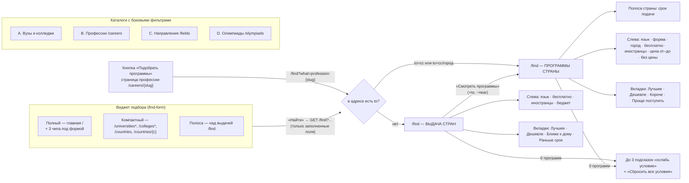
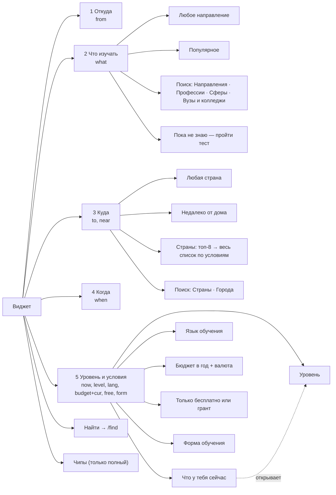
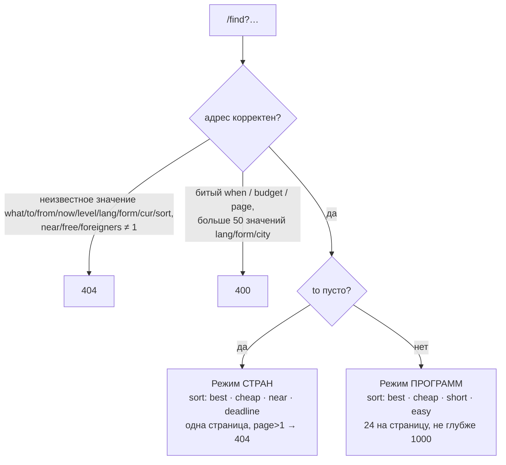
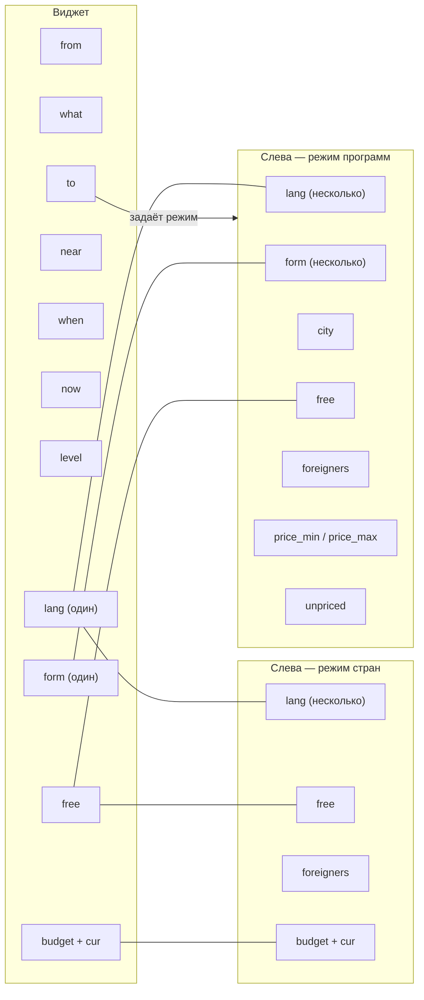
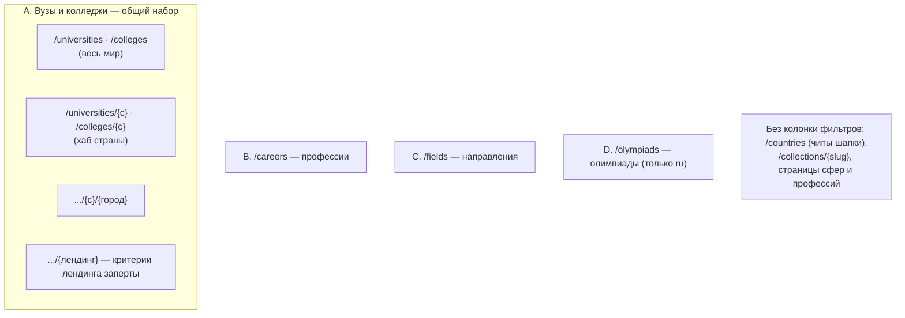
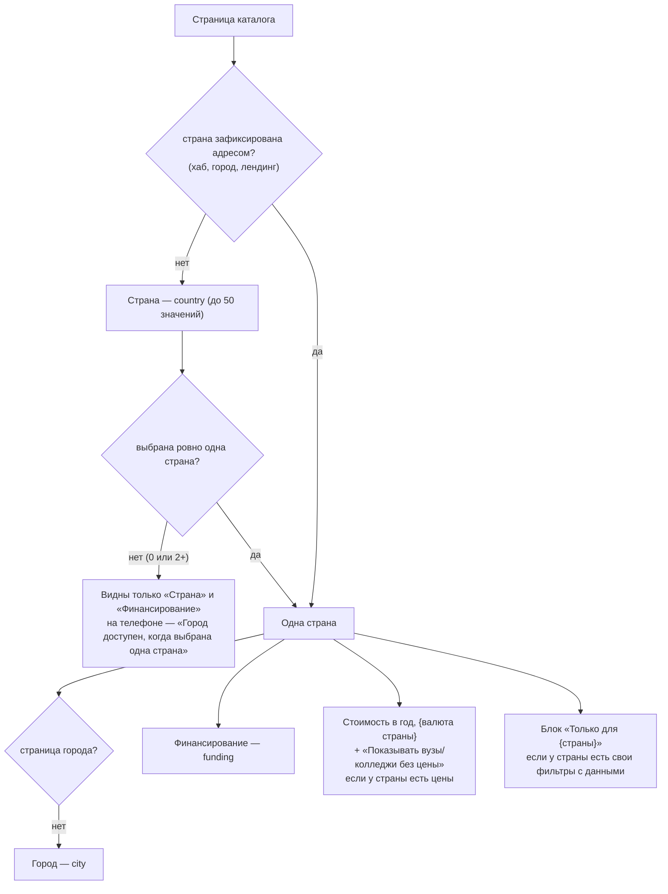

# Фильтры сайта — дерево и связи

Срез кода на 2026-11-12.

Обозначения:
- `param=value` — параметр адреса.
- **Условие** — когда элемент виден; если условия нет, элемент виден всегда.
- Подписи взяты из `themes/kuda/lang/ru.json`.

---

## 1. Общая карта

На всех страницах фильтры работают одинаково:
- Без JS это GET-форма с кнопкой «Показать».
- С JS каждое изменение сразу запрашивает обработчик `filter`. Он заменяет выдачу и пишет новый адрес в строку браузера.
- На телефоне форма открывается снизу листом по кнопке «Фильтры (N)».

---

## 2. Виджет подбора

### 2.1 Где стоит и чем отличаются варианты

| Вариант | Где | Окна полей | Чипы |
|---|---|---|---|
| Полный | `/` (блок `hero`) | Подгружаются обработчиком `panels` при первом открытии поля или клике по чипу | Есть |
| Компактный | `/universities`, `/universities/{c}`, его город и лендинги; то же для `/colleges`; `/countries`; `/countries/{c}` | Как у полного. На странице страны поле «Куда» уже заполнено этой страной | Нет |
| Полоса | `/find` | Нарисованы сразу, выбранное берётся из адреса | Нет |
| Кнопка | `/careers/{slug}` — не виджет | — | — |

Кнопка «Подобрать программы» видна, если у профессии есть направления. Она ведёт на `/find?what=profession:{slug}`.

Пока окна полного и компактного вариантов не подгружены:
- выбранное страницей уходит скрытыми полями;
- «Откуда» берётся из cookie `market`.

### 2.2 Дерево полей

#### 1. «Откуда» — `from=<ISO>`

Пустое поле показывает «Твоя страна».

- Поиск «Поиск страны». Если ничего не нашлось — «Такой страны нет».
- Строки: рынки сайта, затем остальные страны по алфавиту (их добавляет JS).
- Строки «Любая» нет: выбор нельзя сбросить внутри окна.
- Клик по стране пишет cookie `market` и `currency`, и цены на сайте переходят на валюту страны.
- На телефоне поле скрыто, если страна уже известна.

#### 2. «Что изучать» — `what=<вид>:<slug>`

Пустое поле показывает «Любое направление».

- «Любое направление» → `what` пусто.
- «Популярное» берётся из настроек блока. В сиде:

  | Подпись | Значение |
  |---|---|
  | IT и программирование | `sphere:it` |
  | Медицина | `sphere:medicine` |
  | Экономика и бизнес | `sphere:economics` |
  | Инженерия | `sphere:engineering` |

- Поиск «Направление, профессия или вуз» показывает до 3 подсказок на группу. Пустые группы не показываются.

  | Группа | Значение | Подпись справа |
  |---|---|---|
  | Направления | `field:<slug>` | «в N странах» |
  | Профессии | `profession:<slug>` | сфера |
  | Сферы | `sphere:<slug>` | число профессий |
  | Вузы и колледжи | `institution:<slug>` | город и флаг |

- «Пока не знаю — пройти тест» ведёт на mainexperts.online/screening.

#### 3. «Куда» — `to=<cc>` или `to=<cc>/<город>`, а также `near=1`

Пустое поле показывает «Любая страна».

- «Любая страна» → `to` пусто.
- «Недалеко от дома» — флажок `near=1` с подписью «Страны в нескольких часах лёта». Работает, только если известно «Откуда» и не выбрана страна.
- «Страны»:
  - Сначала видны 8 стран с наибольшим числом программ.
  - При открытии окна обработчик `places` приносит все страны, где есть программы под остальные поля формы. У каждой видно «N программ» и «от X в год» или «Бесплатно». Страны не из ответа скрываются.
- Поиск «Страна или город» даёт группы «Страны» (`de`) и «Города» (`de/<slug>`). Города выбираются только через поиск.
- Без JS вместо всего этого — выпадающий список стран.

#### 4. «Когда» — `when=ГГГГ-ММ`

Пустое поле показывает «Ближайший набор».

- Вкладки:
  - «Месяц» — ближайший непрошедший месяц;
  - «Ближайший набор» → `when` пусто;
  - «Пока не знаю» → `when` пусто.
- Два учебных года, например «2026/27». В каждом 12 месяцев, с сентября по август. Прошедшие месяцы неактивны.
- Сноска: «Без месяца подбор покажет ближайший срок подачи.»

#### 5. «Уровень и условия»

Пустое поле показывает «Любые». Внизу кнопка «Готово».

| Блок | Параметр | Варианты | Условие |
|---|---|---|---|
| Что у тебя сейчас | `now` | `school9` «9 классов», `school` «11 классов», `college` «Колледж», `bachelor` «Бакалавриат», `master` «Магистратура». Варианта «любой» нет | — |
| Уровень | `level` | «Любой» и уровни из индекса: Среднее профессиональное, Бакалавриат, Специалитет, Магистратура, Аспирантура, Ординатура, Другие программы | Только уровни, по которым в индексе есть программы. Уровни, которые не открывает `now`, неактивны |
| Язык обучения | `lang` | «Любой» и до 6 языков с наибольшим числом программ | Только языки из индекса |
| Бюджет в год | `budget` и `cur` | Поле «до» и выбор валюты (по умолчанию валюта рынка) | Есть курсы не старше 72 часов |
| Только бесплатно или грант | `free=1` | Переключатель, подпись «Программы с бюджетными местами или грантами» | — |
| Форма обучения | `form` | Очная `full_time`, Заочная `part_time`, Дистанционная `distance`, «Любая» | — |

Как «Что у тебя сейчас» открывает уровни. Сервер применяет эту же таблицу, если `level` не задан:

| `now` | Открытые уровни |
|---|---|
| `school9` | Среднее профессиональное |
| `school`, `college` | Среднее профессиональное, Бакалавриат, Специалитет |
| `bachelor` | Магистратура |
| `master` | Аспирантура |

#### Чипы под формой (только полный вариант)

| Чип | Что переключает | Параметр | Условие |
|---|---|---|---|
| Бесплатно или грант | Переключатель в «Уровень и условия» | `free=1` | — |
| Обучение на английском | Язык «Английский» | `lang=en` | Английский входит в топ-6 языков индекса. Второй клик сбрасывает язык |
| Недалеко от дома | Флажок в «Куда» | `near=1` | — |

---

## 3. `/find` — страница выдачи

### 3.1 Режим и проверка адреса

Страница закрыта от индекса (`noindex, follow`), канонический адрес — `/find`.

Заголовок собирается из частей через «·»: уровень, направление (или «Все направления»), место, месяц, бюджет. Затем идёт «— N стран, M программ».

### 3.2 Режим стран (`to` пусто)

**Боковые фильтры, сверху вниз:**

| # | Подпись | Параметр | Тип | Условие |
|---|---|---|---|---|
| 1 | Язык обучения | `lang` (несколько) | Флажки со счётчиком стран | Языки с числом стран больше 0 или уже выбранные. После 7 строк — «Ещё N» |
| 2 | Бесплатно или грант | `free=1` | Переключатель со счётчиком | Скрыт, если счётчик 0 и переключатель выключен |
| 3 | Есть места для иностранцев | `foreigners=1` | Переключатель со счётчиком | Так же |
| 4 | Бюджет в год, {валюта} | `budget` и скрытый `cur` | Поле «до» и ползунок | Есть курсы. Ползунок — если у цен есть разброс |

Счётчик языка считается так, будто сам язык не выбран. Со счётчиком «Бесплатно» так же.

**Вкладки порядка:**

| Вкладка | Параметр | Видна, когда | Подпись под ней |
|---|---|---|---|
| Лучшее | — (`best`) | Всегда | «по твоим условиям» |
| Дешевле | `sort=cheap` | У какой-то страны есть цена (нужны курсы) | «от X» |
| Ближе к дому | `sort=near` | Известно «Откуда» | «меньше перелёт» |
| Раньше срок | `sort=deadline` | У какой-то страны есть срок подачи | Ближайшая дата |

Страны без нужной цифры уходят в конец.

**Карточка страны:**
- флаг и название;
- справа «от X в год» или «Бесплатно»;
- «N программ» и до двух языков;
- строка срока подачи, если срок есть;
- «N ч лёта», если известно «Откуда»;
- плашка «Есть бесплатные места»;
- кнопка «Смотреть программы» — тот же адрес с `to=<cc>` и без `near`.

**Остальное на странице:**
- После 6-й карточки — баннер теста.
- Видны 8 стран, остальные раскрываются кнопкой «Показать ещё N стран».

### 3.3 Режим программ (`to=<cc>` или `to=<cc>/<город>`)

**Полоса страны.** Срок подачи берётся из календаря страны по уровню (`level` или уровни, открытые `now`) и месяцу `when`.

| Состояние срока | Что видно | Ссылки «Календарь сроков» и «Напомнить о сроке» |
|---|---|---|
| Срок есть | Тёмная полоса «{Страна}, {уровень}: подача на {месяц} — до {даты}» | Есть |
| Срок прошёл | «На {месяц} поздно — ближайший набор {год}» | Есть |
| Событий нет | Светлая полоса «Сроки подачи уточнит эксперт» | Нет |

**Боковые фильтры, сверху вниз:**

| # | Подпись | Параметр | Тип | Условие |
|---|---|---|---|---|
| 1 | Язык обучения | `lang` (несколько) | Флажки со счётчиком программ | Число больше 0 или уже выбран |
| 2 | Форма обучения | `form` (несколько) | Флажки | Так же. Здесь бывает и «Очно-заочная» |
| 3 | Город | `city` (несколько) | Флажки | В `to` нет города, и редакторы страны не выключили фильтр «Город» |
| 4 | Бесплатно или грант | `free=1` | Переключатель | Скрыт при счётчике 0 |
| 5 | Есть места для иностранцев | `foreigners=1` | Переключатель | Скрыт при счётчике 0 |
| 6 | Стоимость в год, {валюта страны} | `price_min`, `price_max` | «от» и «до», ползунок | Редакторы не выключили фильтр «Цена» |
| 7 | Показывать программы без цены | `unpriced` | Переключатель внутри блока цены, включён по умолчанию | Вместе с блоком 6 |

**Вкладки порядка:**

| Вкладка | Параметр | Видна, когда | Подпись под ней |
|---|---|---|---|
| Лучшее | — | Всегда | «по твоим условиям» |
| Дешевле | `sort=cheap` | У программ есть цены в валюте страны, есть курсы, фильтр цены не выключен | «от X» |
| Короче | `sort=short` | У какой-то программы есть длительность | «от N мес.» |
| Проще поступить | `sort=easy` | У какой-то программы есть проходной балл | «проходной от N» |

Карточки идут по 24, кнопка «Показать ещё 24» и номера страниц. Баннера теста в этом режиме нет.

### 3.4 Пустая выдача

Текст: «Под эти условия программ нет». Под ним до 3 подсказок в порядке ниже. Подсказка показывается, если условие есть в адресе и без него программы находятся.

| Порядок | Подсказка | Убирает |
|---|---|---|
| 1 | Без бюджета | `budget`, `cur` |
| 2 | На любом языке | `lang` |
| 3 | И платные места | `free` |
| 4 | Любая форма обучения | `form` |
| 5 | На любом расстоянии | `near` |

У каждой подсказки видно «— N стран, M программ».

Никогда не ослабляются: `foreigners`, цена от–до, `city`, `unpriced`, `what`, `level`, `when`, `now`.

Ссылка «Сбросить все условия» ведёт на чистый `/find`.

---

## 4. Связь виджета и боковых фильтров

Боковая форма `/find` рисует только свои параметры. Остальные параметры адреса она несёт скрытыми полями, поэтому смена фильтра не теряет выбранное в виджете. Номер страницы при смене фильтра сбрасывается.

| Параметр | В виджете | Слева, режим стран | Слева, режим программ |
|---|---|---|---|
| `lang` | Один язык (и чип «на английском») | Несколько флажков | Несколько флажков |
| `free` | Переключатель и чип | Переключатель | Переключатель |
| `budget` + `cur` | «до» и валюта | Поле «Бюджет в год» | Нет поля, но фильтрует (скрытое поле) |
| `form` | Одна форма | Нет поля (скрытое) | Несколько флажков |
| `foreigners` | — | Переключатель | Переключатель |
| `from`, `what`, `to`, `near`, `when`, `now`, `level` | Только виджет | Скрытые поля | Скрытые поля |
| `city`, `price_min`, `price_max`, `unpriced` | — | — | Только слева |

Если слева выбрано несколько языков или форм, виджет показывает только первый.

---

## 5. Каталоги с боковыми фильтрами

### 5A. Вузы и колледжи

Это одни фильтры для `/universities`, `/colleges`, хабов страны, страниц города и лендингов. Разница между страницами — только в условиях.

| # | Подпись | Параметр | Тип | Условие |
|---|---|---|---|---|
| 1 | Страна | `country` (несколько, до 50) | Флажки с флагом и счётчиком. После 7 — «Ещё N стран» и поиск «Найти страну». На телефоне — 4 чипа и окно | Страна не зафиксирована адресом |
| 2 | Город | `city` (несколько) | Флажки со счётчиком. На телефоне — поле с окном | Ровно одна страна и это не страница города. Редакторы не выключили «Город» |
| 3 | Финансирование | `funding`: `public` «Государственные», `private` «Частные» | Флажки со счётчиком | Есть хотя бы одно значение больше 0. Редакторы не выключили фильтр |
| 4 | Стоимость в год, {валюта} | `price_min`, `price_max` | «от» и «до», ползунок, подсказка «≈ … по курсу» | Ровно одна страна, у неё есть цены, фильтр не выключен |
| 5 | Показывать вузы/колледжи без цены | `unpriced` | Переключатель в блоке цены, включён по умолчанию | Вместе с блоком 4. Выключен — в чипах «Только с ценой» |
| 6 | Только для {страны} | См. таблицу ниже | Серая карточка с флагом | Ровно одна страна и хотя бы один её фильтр с данными |

Порядок групп при выбранной стране задают редакторы страны (по умолчанию: город, финансирование, цена). Страна всегда идёт первой. Редакторы могут выключить любой фильтр, поэтому фактический набор зависит от данных.

**Блок «Только для {страны}»** (`country_profile.rs`):

| Страна | Фильтр | Параметр | Тип |
|---|---|---|---|
| Россия | Есть бюджетные места | `budget=1` | Переключатель |
| Россия | Общежитие | `hostel=1` | Переключатель |
| Россия | Военный учебный центр | `military=1` | Переключатель |
| Россия | Специалитет | `specialist=1` | Переключатель |
| Россия | Балл аттестата (**только колледжи**) | `certificate_min`, `certificate_max` | От–до |
| США | Доля принятых, % | `admission_min`, `admission_max` | От–до |
| США | Средний SAT | `sat_min`, `sat_max` | От–до |
| ОАЭ | Эмират | `emirate` | Флажки |
| Турция | Есть места для иностранцев | `foreigners=1` | Переключатель |
| Турция | Проходной балл YKS | `yks_score_min`, `yks_score_max` | От–до |
| Турция | Место в рейтинге YKS | `yks_rank_min`, `yks_rank_max` | От–до |

Как они показываются:
- Переключатель показывает счётчик, если тот больше 0 или переключатель включён.
- Диапазон виден, если цифра есть хоть у одного вуза или граница уже задана.
- Редакторы могут добавить стране фильтр другой страны. Какие страны так сделали, видно только в базе.

**Сортировка** (`sort`):
- «Больше программ» — по умолчанию;
- «По названию» — `name`;
- «Сначала дешевле» — `price`.

Вузы без цены идут в конце списка, о чём говорит подпись.

### 5B. Профессии — `/careers`

Список профессий берётся по рынку языка страницы.

| # | Подпись | Параметр | Тип | Условие |
|---|---|---|---|---|
| 1 | Тип работы | `riasec`: `S` «С людьми», `R` «С техникой», `C` «С данными», `A` «Творчество», `E` «Руководство», `I` «Исследования» | Флажки со счётчиком. На телефоне ещё и таблетки над выдачей | — |
| 2 | Сфера | `sphere` (slug или `other` «Другие профессии») | Флажки со счётчиком | — |
| 3 | Образование | `college=1` «Хватит колледжа» | Один флажок | — |
| 4 | Медиана в месяц, {валюта} | `salary_min`, `salary_max` | «от» и «до» без ползунка | У рынка страницы есть страна |
| 5 | Ещё фильтры · N → Риск ИИ | `risk`: нет, низкий, средний, высокий | Флажки в свёрнутом блоке | Блок раскрыт, если что-то выбрано |

Сортировки нет, порядок — по названию.
- Без выбранной сферы выдача идёт группами по сферам, по 6 профессий в группе, без страниц.
- С выбранной сферой — один список со страницами.

### 5C. Направления — `/fields`

| # | Подпись | Параметр | Тип |
|---|---|---|---|
| 1 | Сфера | `sphere` (slug или `other` «Другие направления») | Флажки со счётчиком |
| 2 | Страна | `country` (до 50) | Флажки с флагом и счётчиком |
| — | Группа CIP | `series` | Поля нет: сюда ведёт ссылка «все» у группы, в чипах значение видно |
| — | «Группировать: По сферам / По группам CIP» | `level=2` (по сферам — по умолчанию) | Переключатель над выдачей, не фильтр |

Сортировки нет, порядок — по числу программ.

### 5D. Олимпиады — `/olympiads` (только русская версия)

| # | Подпись | Параметр | Тип |
|---|---|---|---|
| 1 | Предмет | `subject` | Флажки, по убыванию счётчика |
| 2 | Уровень | `level`: `first`, `second`, `third`, `vsosh` (I, II, III уровень, ВсОШ) | Флажки |
| 3 | Класс | `grade` 1–11 и «Все» | Сегменты |
| 4 | Вид льготы | `benefit`: `no_exams`, `max_score`, `extra_points` | Флажки |
| — | Название или организатор | `q` (до 100 символов) | Поле в шапке, связано с формой фильтров |

Счётчики каждой группы считаются без её собственного выбора.

Порядок один: «Сначала I уровень».

Колонка фильтров видна, если есть хоть одна олимпиада.

---

## 6. Формы, похожие на фильтры (не колонка слева)

| Где | Что | Параметры |
|---|---|---|
| `/countries` | Чипы шапки: «на английском», «бесплатно», «бакалавриат» | `language=en`, `budget=true`, `level=bachelor` |
| Блок «Где учиться» на `/careers/{slug}`, `/spheres/{slug}`, `/fields/{slug}` | Горизонтальная форма | См. ниже |
| Страница вуза | Форма над таблицей программ | См. ниже |
| `/careers/{slug}`, `/spheres/{slug}` | «Зарплата в …» — выбор валюты | — |

Форма «Где учиться», параметры и когда каждый виден:
- `study_kind` (Вузы / Колледжи);
- `study_country`;
- `study_city` — если больше одного города и это не сфера;
- `study_form` — если больше одной формы;
- `study_price`;
- `study_budget`.

Форма над таблицей программ вуза:
- `program_level` — сегменты, если больше одного уровня;
- `program_form` — если больше одной формы;
- `program_budget`;
- `program_search`.

---

## 7. Общая механика

**Отправка.**
- Без JS это GET-форма.
- С JS работает `hx-get` на обработчик `filter` по событию `change`. При быстрых изменениях запрашивается последнее. Адрес пишется в историю браузера.
- Несколько значений одного фильтра идут в адресе через запятую: `country=gb,us`.

**Чипы и сброс.**
- Над выдачей видны выбранные условия чипами. Крестик на чипе убирает одно условие.
- «Сбросить» убирает все фильтры, но сохраняет порядок и вид (карта).

**Телефон** (до 1024 px):
- Фильтры открываются листом по кнопке «Фильтры (N)».
- Вверху листа — «Сбросить».
- Внизу — «Показать N вузов». При 0 кнопка гаснет: «0 вузов — измени фильтры».

**Пределы.**

| Что | Значение |
|---|---|
| Значений одного фильтра | До 50 |
| Глубина выдачи | До 1000 записей, дальше 404 |
| Карточек на страницу | 20 в каталоге вузов, 24 в профессиях, направлениях, олимпиадах и программах `/find` |

**Индексация.** Адрес с фильтрами закрыт от индекса, канонический адрес — без фильтров.

---

## 8. Правила работы фильтров

Правила взяты из кода. Подписи «проверено в браузере» стоят там, где правило дополнительно прогнано на превью.

### 8.1 Главные правила

| Правило | Как работает | Где в коде |
|---|---|---|
| Внутри одной группы | **ИЛИ**. «Немецкий» + «Английский» = программы на немецком **или** на английском | `crates/portal-search/src/browse.rs:110, 636-650` |
| Между группами | **И**. Язык И форма И город И переключатели И цена | Там же |
| Переключатель | Одно условие, которое добавляется через И. Включён «Бесплатно или грант» — остаются только программы с бюджетными местами или грантами | Там же |
| Диапазон (цена, бюджет, баллы) | Через И. Если «Показывать … без цены» включён, записи без цены тоже проходят | `browse.rs:665-678, 788-796` |
| Счётчик рядом со значением | Пересчитывается при каждом изменении по всем **остальным** условиям. Собственный выбор группы не учитывается, поэтому число показывает, сколько записей даст это значение при остальных условиях | `browse.rs:140-142, 230-245` |
| Значения с нулём | Скрываются, если не выбраны. Переключатель с нулём скрыт, если выключен | `catalog/filters.rs:191`, `find/countries.rs:123-147` |
| Смена фильтра слева | Номер страницы сбрасывается на 1-ю. Порядок выдачи и всё выбранное в виджете сохраняются | `find/mod.rs:703-718`, `catalog-filters.html:35-42` |

Счётчик на примере выдачи «IT · Бакалавриат · Германия · английский»:
- у «Английского» 45 — это и есть выдача;
- у «Немецкого» 598 — столько программ IT-бакалавриата в Германии на немецком;
- отметить оба — 45 + 598, если у программы один язык.

Олимпиады считаются без индекса, но правило то же: ИЛИ внутри группы, И между группами, счётчик группы — без её собственного выбора (`olympiad/list.rs:185-205`).

### 8.2 Таблица по каждому фильтру

Колонка «Выбор»: «один» — радиокнопка или одно значение, «несколько» — флажки.

**Виджет и `/find`**

| Фильтр | Параметр | Выбор | Внутри группы | От чего зависит, на что влияет | Может дать ноль |
|---|---|---|---|---|---|
| Откуда | `from` | Один | — | Сам выдачу не сужает. Нужен для «Ближе к дому», «N ч лёта», «Недалеко от дома» | Нет |
| Что изучать | `what` | Один | — | Сужает до программ направления, профессии или сферы (через их семейства CIP) либо одного вуза | Да |
| Куда | `to` | Один: страна или город | — | Пусто — выдача стран, задано — программы страны. Сужает все списки и счётчики слева | Нет: в списке только страны с программами |
| Недалеко от дома | `near` | Флажок | — | Работает, только если известно «Откуда» и страна не выбрана | Да |
| Когда | `when` | Один месяц | — | **Выдачу не сужает.** Меняет только срок подачи в полосе и карточках и вкладку «Раньше срок» | Нет |
| Что у тебя сейчас | `now` | Один | — | Если уровень не выбран, оставляет уровни, которые открывает (таблица в 2.2). При выбранном уровне не действует | Да. Пример: «9 классов» + Германия = 0 программ (проверено в браузере) |
| Уровень | `level` | Один | — | В виджете неактивны уровни, которые не открывает «Что у тебя сейчас». В адресе уровень важнее: `now=school9&level=master` показывает 9 601 программу магистратуры (проверено в браузере) | Да |
| Язык обучения | `lang` | Виджет — один, слева — несколько | ИЛИ | Список языков — только те, что есть при остальных условиях | Слева нет |
| Бюджет в год | `budget` + `cur` | Одно число | — | Цена программы переводится в USD и сравнивается с потолком. Валюта без курса не проходит. Без цены проходит, если включено «Показывать без цены» | Да |
| Бесплатно или грант | `free` | Переключатель | — | Скрыт, если таких записей нет | Слева нет, в виджете да |
| Форма обучения | `form` | Виджет — один, слева — несколько | ИЛИ | Список — только формы, что есть при остальных условиях | Слева нет |
| Есть места для иностранцев | `foreigners` | Переключатель | — | Только слева | Нет |
| Город | `city` | Несколько | ИЛИ | Только в режиме программ, если в «Куда» нет города. Города — только выбранной страны | Нет |
| Стоимость от–до | `price_min`, `price_max` | Диапазон | — | Только в режиме программ, в валюте страны | Да |
| Показывать без цены | `unpriced` | Переключатель, включён по умолчанию | — | Выключен — записи без цены уходят из выдачи | Да |
| Порядок | `sort` | Один | — | Вкладка видна, только если у выдачи есть нужная цифра (раздел 3) | Нет |

**Каталоги**

| Фильтр | Где | Параметр | Выбор | Внутри группы | От чего зависит | Может дать ноль |
|---|---|---|---|---|---|---|
| Страна | Вузы, колледжи, направления | `country` | Несколько, до 50 | ИЛИ | Вузы и колледжи: только когда страна не задана адресом | Нет |
| Город | Вузы, колледжи | `city` | Несколько | ИЛИ | Только при **одной** стране и не на странице города | Нет |
| Финансирование | Вузы, колледжи | `funding` | Несколько | ИЛИ | — | Нет |
| Стоимость от–до + без цены | Вузы, колледжи | `price_min`, `price_max`, `unpriced` | Диапазон | — | Только при одной стране с ценами | Да |
| Блок «Только для страны» | Вузы, колледжи | См. раздел 5A | Переключатели и диапазоны; «Эмират» — несколько | Эмират — ИЛИ | Только при одной стране | Диапазоны — да |
| Тип работы, Сфера, Риск ИИ | Профессии | `riasec`, `sphere`, `risk` | Несколько | ИЛИ | — | Нет |
| Хватит колледжа | Профессии | `college` | Флажок | — | — | Нет |
| Медиана в месяц | Профессии | `salary_min`, `salary_max` | Диапазон | — | У рынка страницы есть страна | Да |
| Сфера | Направления | `sphere` | Несколько | ИЛИ | — | Нет |
| Предмет, Уровень, Класс, Вид льготы | Олимпиады | `subject`, `level`, `grade`, `benefit` | Несколько | ИЛИ | — | Нет |
| Название или организатор | Олимпиады | `q` | Текст | — | — | Да |

«Может дать ноль: нет» значит, что ноль не получится, если отмечать только видимые значения: значения и переключатели с нулём скрыты. Через ручную правку адреса ноль можно получить всегда.

### 8.3 Ответы на вопросы

**Сужаются ли списки после выбора страны?**
- Да, для всех групп, не только для городов.
- Каждый список значений считается по выдаче при всех остальных условиях, включая страну, город и направление из виджета. Значения с нулём скрываются.
- Пример: после выбора Германии в «Языке» и «Форме обучения» остаются только языки и формы немецких программ.
- Отдельные зависимости:

  | Что | Когда видно |
  |---|---|
  | Город (каталоги) | Только при одной стране |
  | Цена и блок «Только для страны» | Только при одной стране |
  | «Недалеко от дома» | Только при известном «Откуда» и без выбранной страны |

**Пересчитываются ли счётчики?**
- Да, при каждом изменении любого условия — это правило, а не случайность.
- Исключение: счётчики группы не учитывают выбор в этой же группе. Иначе у неотмеченного языка всегда стоял бы 0.

**Влияет ли «Что у тебя сейчас» на уровни?**
- Да. В виджете уровни, которые эта ступень не открывает, неактивны. Отмеченный неактивный уровень сбрасывается на «Любой» (`themes/kuda/src/islands/find.ts:138-148`).
- При «9 классах» «Магистратуру» в виджете выбрать нельзя.
- Если уровень не выбран, сервер ограничивает выдачу открытыми уровнями.
- Если уровень пришёл в адресе, он важнее «Что у тебя сейчас» (`find/mod.rs:382-388, 448-450`).

**Что при нуле результатов?**

| Где | Что видит посетитель |
|---|---|
| `/find` | «Под эти условия программ нет». Под ним до трёх подсказок «ослабь условие» с числом результатов (порядок — раздел 3.4) и ссылка «Сбросить все условия». Если ни одна подсказка не помогает — «Под все условия ничего нет. Убери одно из них или начни заново.» |
| Каталоги и олимпиады | «Ничего не нашли», пояснение «Таких вузов в {месте} нет: выбранные фильтры вместе ничего не оставляют. Убери один из фильтров.» и кнопки «Сбросить фильтры» и «Убрать «{последний выбранный фильтр}»». В каталоге ниже карточка эксперта |
| Телефон | Кнопка листа фильтров становится неактивной: «0 вузов — измени фильтры» |

Подсказки `/find` снимают только бюджет, язык, «бесплатно», форму и «недалеко». «Что у тебя сейчас», уровень, направление, месяц, город, цену и «для иностранцев» они не предлагают. Поэтому «9 классов» + Германия дают ноль без подходящей подсказки.

**Синхронизированы ли виджет и боковые фильтры?** (проверено в браузере)

| Направление | Что происходит |
|---|---|
| Виджет → слева | Да. «Найти» перезагружает страницу, и слева отмечено то же: язык и «бесплатно»; бюджет — в выдаче стран; форма — в выдаче программ |
| Слева → виджет | Только после перезагрузки страницы. Виджет показывает один язык и одну форму — первые из выбранных |
| Слева → виджет без перезагрузки | Нет: виджет показывает прежний выбор |
| «Найти» после выбора слева | Адрес собирается только из полей виджета. Второй язык, город, цена, «для иностранцев», «без цены» и порядок пропадают. Это дефект — [#268](https://github.com/sergei3456/mainexperts-portal/issues/268) |
| Смена фильтра слева | Выбор виджета не теряется: он уходит скрытыми полями |
